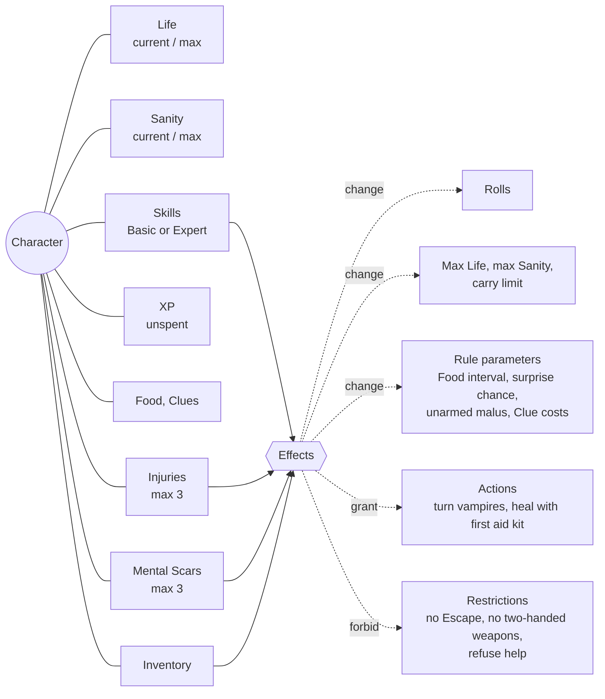
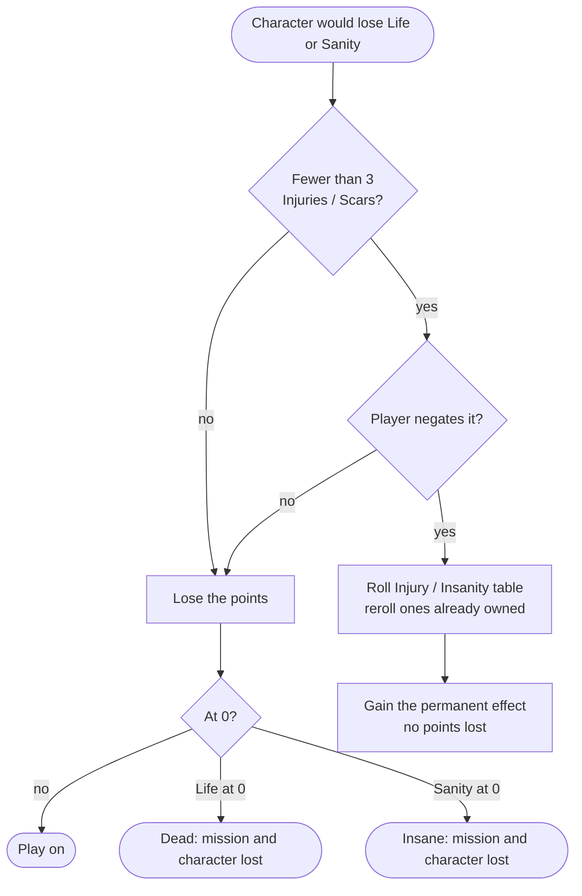
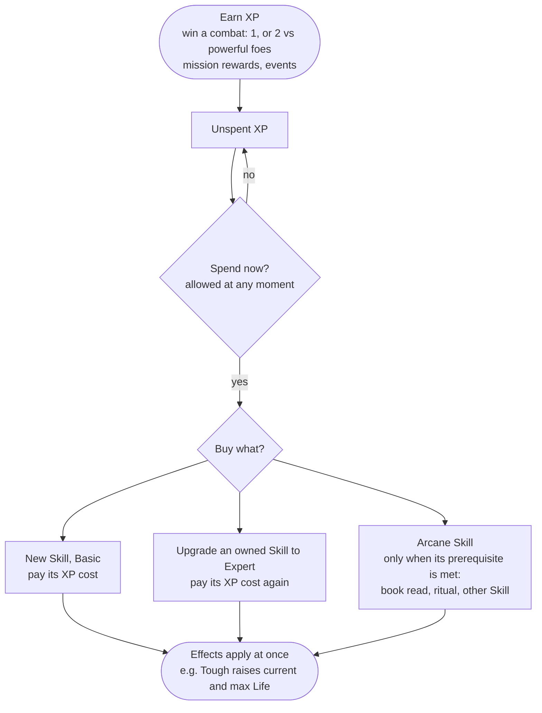

# Character and progression

What a character is made of, how it changes during play, and how it ends. Words are defined in the [glossary](glossary.md).

## Concept map

A domain map, not a code design.

Skills, Injuries and Mental Scars look different in the book but are the same thing: **permanent effects** on the character. Items and temporary game effects (curses, "lasts 3 boxes") are effects too. Five kinds cover every Skill, Injury and Scar in the book:

| Kind | Examples |
|---|---|
| Roll modifier | Charisma +1, Fighter +1 to hand-to-hand Attack, Facial scar -1 to Charisma, Phobic -1 vs Fear |
| Stat modifier | Tough +2 max Life, Strong Grip on Reality +1 max Sanity, Shaky -1 max Sanity, Strong +3 carry limit |
| Rule parameter | Resistant to Hunger (Food every 6 boxes), Eating Disorder (every 3), Danger Sense (-1 surprise), Martial Arts, Investigator (Clue costs) |
| New action | Faith (turn vampires), Medic (heal after an encounter) |
| Restriction | Overconfidence (no Escape above 2 Life), Crippled arm (no two-handed weapons), Paranoia (refuse help) |

## Rolls carry tags

A modifier applies only to some rolls: "Attack rolls with hand-to-hand weapons", "saves vs poison", "Attack rolls against vampires", "Will rolls and saves vs Fear". So a roll is more than "d6 vs L": it has a **type** and **context tags**. Each effect says which rolls it applies to. The list lives in [rolls](rolls.md).

Special cases already visible:

- **Non-stacking**: Agile and Dodge both give Defense bonuses, use only one.
- **Side effects**: Dodge makes a natural 1 on Defense give -1 to the next Attack.
- **Natural results**: natural 1 fails and natural 6 succeeds whatever the modifiers. On Search a natural 1 stays 1.

## Life and Sanity

Ways to recover Life and Sanity (never above max):

- healing at a Safe House
- helpful people met in encounters
- a first aid kit (Medic)
- resting in calm places
- end of mission: both go back to max

An Injury can also be forced on the character: the Zombie Tiger inflicts one on a natural 1 on Defense ("if you already have 3 Injuries, lose 3 Life instead").

An Injury or Scar negates the whole loss, not just 1 or 2 points (see [rulings](rulings.md), switchable).

## XP and Skills

- At creation: 2 free Basic Skills, no Arcane, no Expert.
- Fleeing gives no XP. Winning means defeating through combat, magic or exorcism.
- Some Skills are "hidden in events or item descriptions": the Skill list is open, content can add Skills.
- Reading a book takes d3 boxes of time: an action that advances the clock without moving.

Expert costs the Skill's XP cost again (see [rulings](rulings.md)).

## What this reveals

- **One concept, "effect", covers Skills, Injuries, Scars, items and temporary states.** Five kinds are enough so far. Whether they stay enough is the main thing to check when we design combat.
- **Rolls need tags** so effects can target them. This is the core of the rules engine, more than dice.
- **Max values are calculations, not numbers on the sheet.** Max Life = base + effects (Tough), max Sanity = base + effects (Strong Grip on Reality, Shaky), carry limit = 10 + effects (backpack, Strong). The sheet keeps the base values, the current Life and Sanity, and the list of effects; max values are recalculated whenever asked, so gaining or losing an effect mid-game can never leave them out of date.
- **Changing a max can change the current value.** Gaining Tough raises max and current Life by the same amount, it does not heal to full (6/10 becomes 8/12). Losing max (Shaky) caps the current value at the new max. Losing carry capacity (backpack stolen) forces dropping items.
- **Some actions take time without moving** (reading a book). The clock is not only movement.
