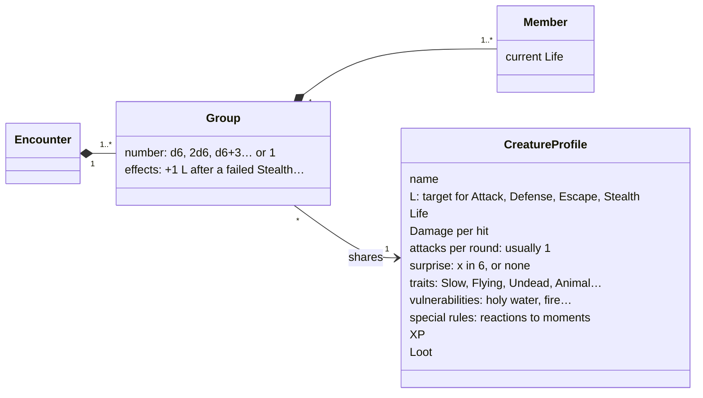
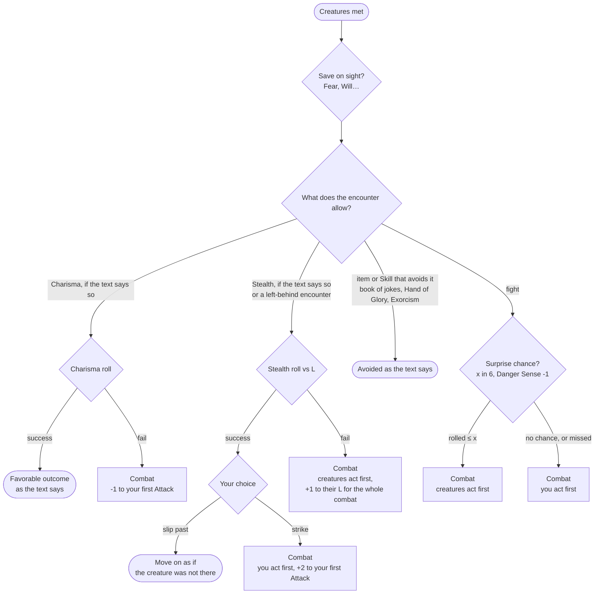
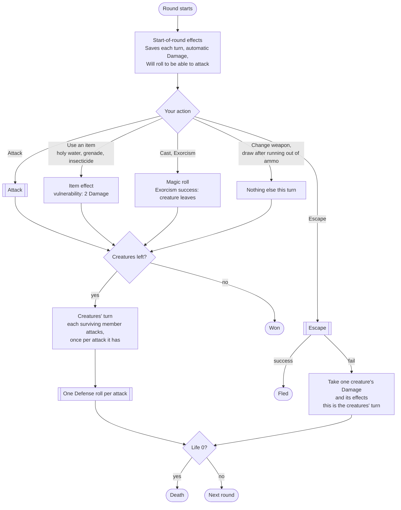
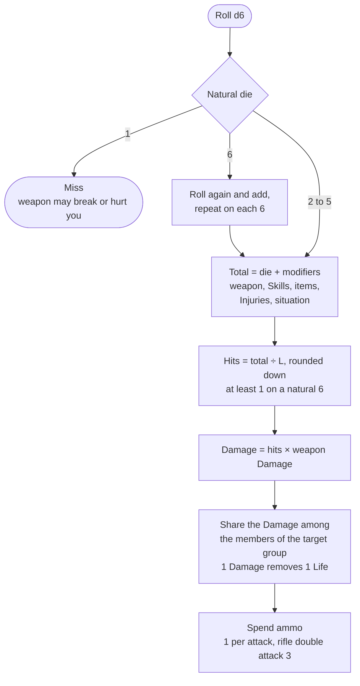
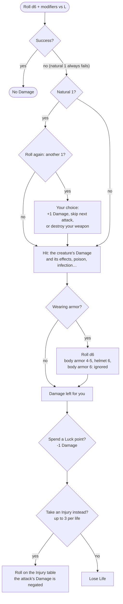
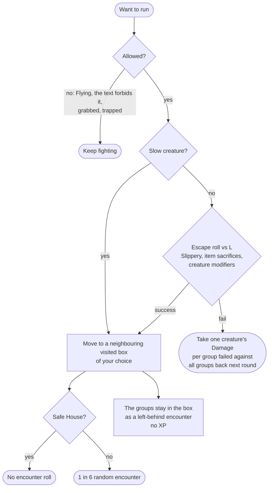
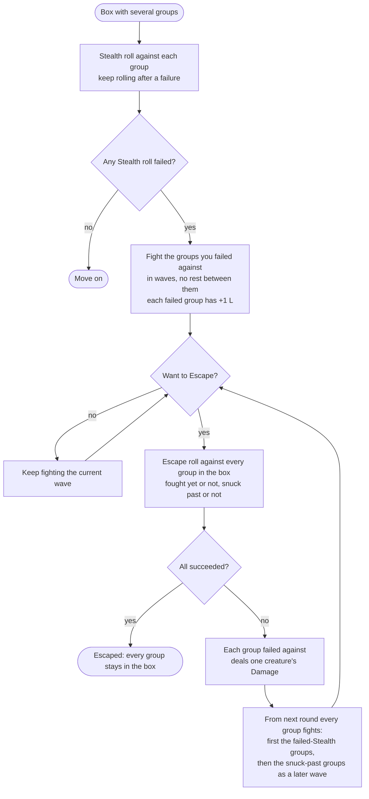
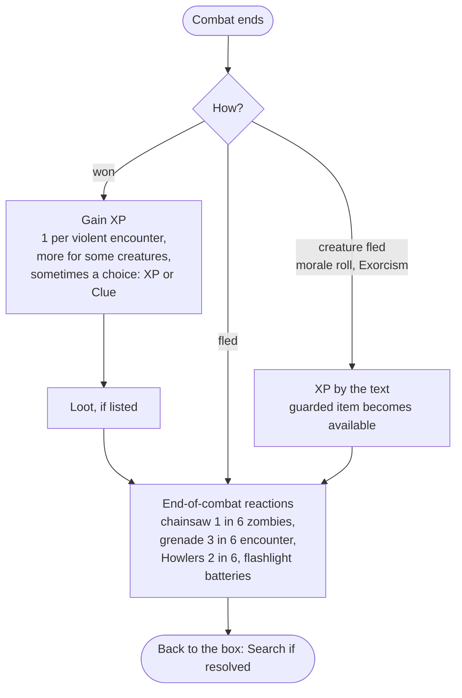

# Combat

How a fight with creatures starts, runs and ends. Words are defined in the [glossary](glossary.md). Sources: `3_combat.md`, `4_monster_rules.md`, `1_4_weapons.md`, `8_weapon_summary_table.md`, armor in `2_2_useful_stuff_table.md`, and the creature tables. Interpretations are in [rulings](rulings.md).

## Creature profile

- A **group** is what one table result produces: "2d6 Zombies" is one group. Its members share a profile but each keeps its own Life (Howlers have 2 Life each).
- An encounter can hold **several groups with different profiles** fighting together: Kalina and her toy dinosaur attack "at the same time", and each round you choose whom you attack.
- **Traits** are tags. Effects target them (Zombie Hunter, +1 vs Undead with the bat), and some change the rules (Slow: free Escape; Flying: no Escape).

## From meeting to fighting

- Surprise is rolled only when nothing else decided who acts first.
- Fear Saves "at the beginning of the combat" and "the first time you see it in the campaign" are reactions to moments, not part of the flow.

## A round

The book says "turn" for both your action and a full exchange. We say **round**: your turn plus the creatures' turn. If the creatures act first, the first round starts with their turn.

- **Only members alive after your turn attack you**, each with one Defense roll per attack (`3_combat.md`: "you will have to defend only against the 4 remaining zombies").
- **One action is your whole turn** ([rulings](rulings.md)): changing weapons, drawing after running out of ammo, using a vulnerability, throwing a grenade, standing up each take it. Some things are free: firing a curse, Luck points, sacrificing a toy for an Escape bonus.

## Attack

- **Natural 1 and 6**: a natural 1 is 0 hits, a natural 6 at least 1 hit, whatever the modifiers ([rulings](rulings.md)).
- Worked example from the book: shotgun (+2, Damage 2) vs L3 Zombies, total 7: 7 ÷ 3 = 2 hits, 4 Damage, 4 zombies down.
- **Weapon specials** react to the natural die: breaks on 1 (kitchen knife, replica sword, chair on 1-2), hits yourself on 1 (flail), Damage 2 on a 6 (hockey stick, flail), decapitates on a natural 6 (scythe).
- **Creature specials** react to an attack: the giant bug's exoskeleton (roll d6, on a 1 no Damage), flaming skeletons burn unarmed attackers.
- **Automatic Damage** skips the roll: vulnerability (2 Damage), grenade (4 Damage shared, excess on you), Molotov (destroys 1 zombie, or +2 Attack otherwise), insecticide, rat poison.

## Defense and taking Damage

- **A natural 1 on Defense is always a hit** (`1_1_main_rules.md`, Saves). Rolling again only checks for a fumble, it is not a second chance (`3_combat.md`, Rolling Ones). Master Scarecrow and the Giant Worm hit harder on that 1.
- Other things also react to a natural 1 on Defense: Dodge (-1 to your next Attack), Zombie Tiger (forced Injury), Brain Eaters (grabbed, no Escape).
- A natural 6 on Defense can matter too: the nunchaku disarms.
- Armor has its own Life and breaks at 0. With body armor and helmet together: 3-5 body armor, 6 helmet.

## Escape

- Escaping a group: one roll, "it makes no difference whether you are running away from a single opponent or a group of monsters" (`3_combat.md`). Several groups: one roll each, all or nothing; failed groups each deal one creature's Damage and every group is back next round ([rulings](rulings.md)).
- A failed Escape is the creatures' turn: they do not attack again that round ([creator answers](creator-answers.md)).
- Some creatures **pursue** (the Zombie Abominion: 2 in 6 in each of the next 3 boxes, healed). Some leave a lasting effect even when you escape (the hell hound's baying).

## Several groups: waves

When you come back to a box holding several left-behind encounters (see [game flow](game-flow.md)), you sneak or fight each group. The creator answer covers Stealth and waves; how Escape works with them is our ruling ([rulings](rulings.md)).

- Each wave is a combat on its own: surprise, "for the whole combat" effects and XP are per wave.
- A failed Stealth roll gives +1 L only to the group it was rolled against.
- An Escape must always succeed against every group in the box, the snuck-past ones included. Only the groups you failed against deal Damage.

## Ending a combat

## Ammo and weapons

- Each ranged weapon has its own ammo count, by ammo type (bullets, rifle bullets, bolts, arrows, shells, throwing knives). Same weapons share ammo.
- 1 ammo per Attack, however many creatures die: ammo is an abstract "amount of shooting". The rifle's double attack spends 3.
- Out of ammo mid-combat: 1 turn to draw another weapon, or use the rifle as a club (-1, Damage 1).
- One-use weapons (grenade, Molotov) are spent. Weapons that break are discarded.
- Weapons can be destroyed by a Defense fumble, or taken by a creature (Snowy Samuel disarms you).

## What this reveals

- **Combat is a loop of game moments.** Rules hook into: combat start, round start, your attack (natural die, total, hits), a kill, the creatures' turn, each Defense roll (natural 1, natural 6, failed), taking Damage, a creature's Life threshold (cat flees at 2-3 Damage, tentacled horror at 1 Life), combat end, and leaving the box. This is the list for the effects and game moments topic.
- **The natural die matters, not only the total.** Explosion, fumble, weapon breaks and decapitation read the die before modifiers. A roll result must keep both.
- **Damage taken is a pipeline.** Armor, Luck, Injury, then Life. The order is a ruling, and each step is an effect reacting to "you take Damage".
- **The player chooses inside the loop**: whom to attack, how to share Damage among members, the fumble penalty, armor or Injury, Luck. The engine asks, the interface answers.
- **The effect kinds hold up.** Combat adds no new kind: weapons and items are roll modifiers, rule parameters (Damage, ammo per attack), new actions (use holy water), restrictions (no Escape) and reactions. Two needs grow: effects scoped to **one combat** or **one attack** ("first Attack +2", "for the whole combat +1 L"), and effects that **target a creature** rather than the character (+1 to their L, -1 to Witch Children L for the campaign).
- **Creatures have state too**: current Life per member, wounds kept when left behind, effects on them. They are not just table rows.
