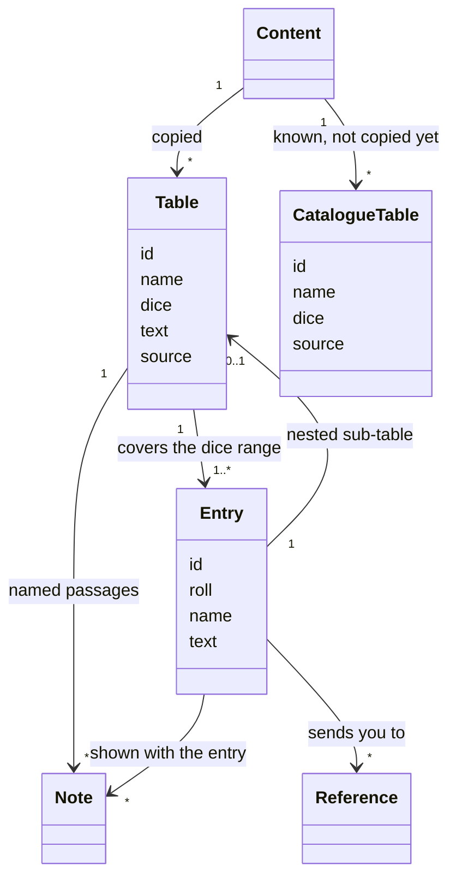

# Rules text in YAML

How the rules text is stored for the engine: files, IDs, the shape of a table, references between tables, and what is known but not copied yet. Why the text is copied at all is in [MVP scope](mvp-scope.md#where-the-text-comes-from). Words are defined in the [glossary](glossary.md). Decided in the R1 session.

## Structure



- **YAML holds the text, Python the behaviour**, both keyed by the same ID ([D1](../Readme.md#deferred)). The YAML holds no rules logic.
- **The text is copied as printed.** OCR damage is fixed against the original PDFs in `origin_rules/`, and page references become table names ("Roll on the Clinic table (p. 46)" becomes "Roll on the Clinic table"), and words that point at the page layout are dropped ("the Mission table below"). Nothing else changes. The Markdown in `gameRules/` is fixed in the same batch, so both copies say the same thing.

## Files

```
src/alone_against_fear/content/
  catalogue.yaml          every table not copied yet
  tables/
    town_exploration.yaml one file per table
    random_encounter.yaml
    search.yaml
    mission.yaml
    (later places/, creatures/ … as the batches need)
```

- The files live in the package, so the engine finds them wherever it is installed.
- **One file per table.** The YAML batches run in parallel sessions, and one file per table keeps them from touching the same files.
- **The ID is inside the file**, not taken from its name or folder. Files can be moved or regrouped later without changing any ID. The loader reads every `*.yaml` under `content/`.

## IDs

Lowercase words joined by `_`, segments joined by `.`. **The first segment is the kind**: `table`, `mission` so far; `event`, `creature`, `item`, `skill`… are added by the batch that first needs them.

| What | ID | Rule |
| --- | --- | --- |
| A table | `table.town_exploration` | a short name from the table's heading, without "table"; `/` becomes `_or_` (`table.woods_or_park`). The heading's number is kept ("Random book table" gives `table.random_book`); "Search rolls table" is `table.search`, the name the rules use |
| An entry | `table.town_exploration.7` | table ID, then the roll as printed: `7`, `2-5` |
| An entry of a nested table | `table.random_encounter.3.3-5` | parent entry ID, then the roll |
| A named entry | `mission.bring_home_the_bacon` | an entry that is a thing of its own takes that thing's ID instead |

- **IDs are stable.** The game state refers to content by ID only, so an ID is never renamed once used.
- **Rolls in IDs keep the book's numbers.** The book's "1,2)" is written `1-2`.
- **Named entries**: a mission is something the game keeps track of ("the mission you played last time"), so it gets a readable ID instead of `table.mission.3`. Creatures, items and events decide their IDs in their own batch (R2 to R7), with the same idea.

## A table

```yaml
id: table.random_encounter
name: Random Encounter table
dice: d6
source: gameRules/tables/5_2_random_encounters_table.md
notes:
  unique_creatures: When rolling on tables of Unique creatures, reroll any monster that …
entries:
  - roll: 3
    table:                 # roll d6, then another d6
      dice: d6
      entries:
        - roll: 6
          text: Roll on the Unique Vampires table.
          refs: [table.unique_vampires]
          notes: [unique_creatures]
```

| Field | Of | Meaning |
| --- | --- | --- |
| `id`, `name`, `dice` | table | `dice` is `d6`, `2d6` or `d66` so far |
| `source` | table | the readable Markdown copy |
| `text` | table | the table's own rules: when to roll it, its modifiers ("Roll at +1 if you have the Investigator Skill") |
| `notes` | table | named passages that some entries point to |
| `roll` | entry | one number, or a range `2-5` |
| `text` | entry | the entry as printed |
| `name`, `id` | entry | for named entries only |
| `refs` | entry | the tables and events the entry tells you to roll on or play |
| `notes` | entry | the table's notes that apply to this entry |
| `table` | entry | a nested table, for "roll d6, then another d6" |

- **Entries cover the dice range exactly**: every result has one entry, no gaps, no overlaps. Nested tables too.
- **A nested table** is used only where the book prints one (Random Encounter). An entry that says "Roll d6. On a 1-5 … On a 6 …" stays one entry with its text, as printed (Town Exploration 7).
- **`text` and `notes` differ in who reads them.** The engine applies a table's own rules (it rolls Town Exploration in new boxes, it adds the Investigator bonus), so book mode does not need to show them on every roll, only when the player asks. A note is a rule about some results, which the player must apply by hand until the engine does: book mode shows it with every entry that points to it. The Random Encounter's sentence on Unique creatures is printed under 6 / 4-6 but applies to Unique Vampires on 3 / 6 and 6 / 1-3 too, so it is a note pointed to by all three.
- **`refs` serve book mode**: the "go to a table or event" action can offer them directly. They are not a script: what the entry does with them (choose one, roll to pick) is in its text, and later in Python (E10).

## Known but not copied yet

- **`catalogue.yaml` lists every table not copied yet**, with its ID, name, dice and Markdown source. A reference to a catalogued table is valid.
- **Each batch moves its tables out** of the catalogue into their own files. When the catalogue is empty, Milestone 3 is done.
- **Book mode uses it as the fallback**: until a table is copied, the engine can still roll its dice and point to the Markdown file and entry number ([MVP scope](mvp-scope.md#where-the-text-comes-from)).
- It lists the tables of `gameRules/tables/`, so every table ID is already fixed. Tables printed inside an event (the Fluid table) come with the events batch, R6. The optional random Skill tables come after the MVP. Events are added by the batch that first refers to one.

## Checks

Tests over the whole content:

- every table and nested table covers its dice range exactly;
- every reference points to an existing ID: a table, an entry, or a catalogued table;
- every note an entry points to exists in its table;
- IDs are unique and follow the scheme;
- every table file of `gameRules/tables/` is the source of exactly one table, copied or catalogued;
- no page reference is left in the text.

## Open

- **Where plain data goes** (creature stats, item weights, Skill XP costs): next to the text in the YAML, or in Python next to the behaviour. Decided in E6 ([D1](../Readme.md#deferred)).
- **How book mode shows a table's own rules**: on request, or the first time the table is rolled. Decided in E5.
