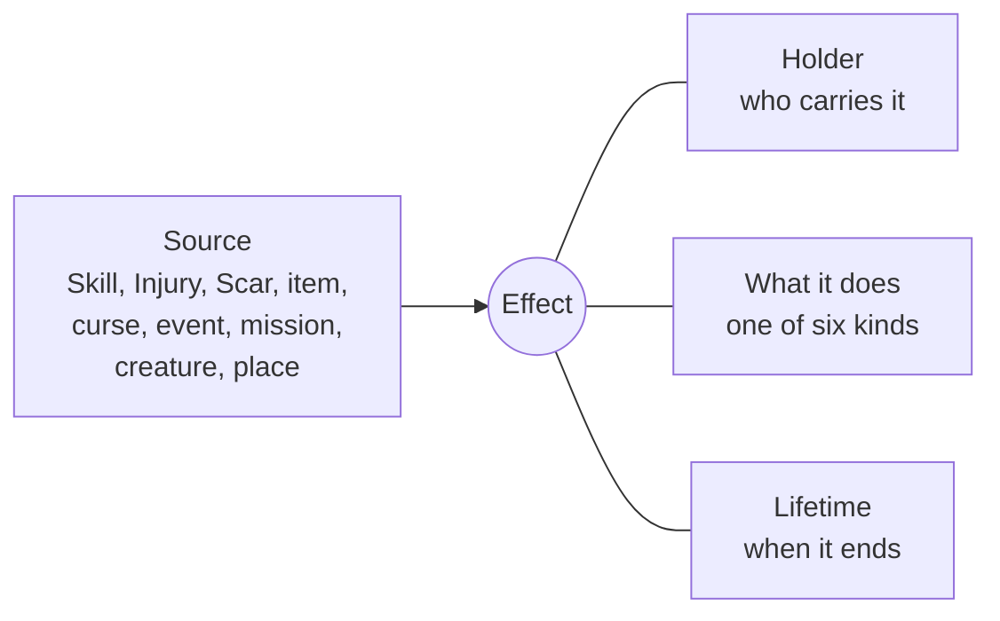
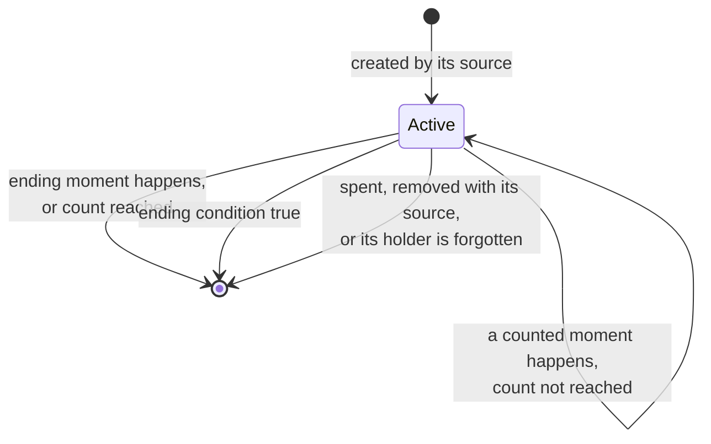
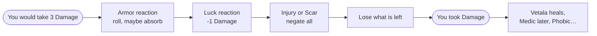
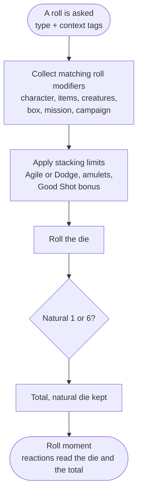

# Effects and game moments

The two concepts every topic so far ran into: **effects** change the rules, **moments** are the points in play that effects hook into. This page gathers what the [character](character.md), [inventory](inventory.md), [combat](combat.md) and [encounters](encounters.md) pages found about them. Words are defined in the [glossary](glossary.md). Interpretations go to [rulings](rulings.md).

## What an effect is

An effect is one rule change. Every effect in the book answers four questions: where it comes from, who holds it, what it does, and when it ends.

- **Source** — what created it. Several effects can share one source: the Desecrated Church cultists, a curse, the Zombie Abominion's pursuit. Removing the source removes its effects (dropping an item, healing a wound).
- **Holder** — see [who holds an effect](#who-holds-an-effect).
- **What it does** — see [kinds](#what-an-effect-does).
- **Lifetime** — see [when an effect ends](#when-an-effect-ends).

## What an effect does

The five kinds found in the [character](character.md) page, plus reactions, found in [inventory](inventory.md) and [combat](combat.md). Combat and encounters added no new kind.

| Kind | Changes | Examples |
| --- | --- | --- |
| Roll modifier | a roll's total, for rolls matching a type and tags | Fighter +1 hand-to-hand Attack, curse -1 on all rolls, Witch Children -1 L for the campaign |
| Stat modifier | a calculated value | Tough +2 max Life, backpack +5 carry limit |
| Rule parameter | a number or switch the rules read | Food every 6 boxes, surprise chance -1, rifle spends 3 ammo |
| New action | what the player may do | Faith turns vampires, Medic heals after an encounter, Luck points |
| Restriction | what the player may not do | no Escape (Flying, grabbed), no two-handed weapons, no fire until the next encounter is over |
| Reaction | what happens at a moment | armor rolls when you take Damage, lose 1 Life on each box until a Safe House, read #25 when your blade hits |

- The first five are **read** by the rules when they need them: a roll collects its modifiers, the carry limit collects its stat modifiers, the action menu checks restrictions.
- A **reaction** acts on its own when its moment comes. Its body is a script of steps, the same steps as a table result ([encounters](encounters.md#what-a-result-is-made-of)): a roll, a gain or loss, a chain to an event, a choice. A deferred event is a reaction whose script is "play #25". A timed step ("as you leave, the farm is attacked") is a reaction armed by a result.

## Who holds an effect

| Holder | Examples |
| --- | --- |
| Character | Skills, Injuries, Scars, curses, infection, Luck points, deferred #25 |
| Item | weapon modifiers, armor, scarab, flowers. Active while the item is owned, or held for a weapon |
| Creature or group | +1 L after a failed Stealth, Charisma -1 on the first Attack against it, kept wounds |
| Box | Safe House healing, cultists 2 in 6 on each return, religious symbol on each visit |
| Mission | mission rules: Food found on Street, Store and Farm visits, a Hell Gate after 12+d6 new boxes |
| Campaign | Witch Children -1 L, SNOWY unlocking a result |

- The holder decides **when the effect is forgotten**: it follows the [nested lifetimes](encounters.md#what-the-game-remembers). A character's curse dies with the character, a campaign effect outlives every character. The town/person test of the encounters page picks the holder.
- The holder is **not always the target**. Witch Children -1 L is held by the campaign and targets creatures from one table. A failed Stealth roll gives the group +1 L: held by the group, read by your Attack rolls against it.
- Roll modifiers are collected from **every holder in play**: the character, its items, the creatures in the fight, the box, the mission, the campaign.

## When an effect ends

The book uses many lifetimes. Almost all of them read the same way: the effect ends when **a moment happens**, sometimes after a count, or when **a condition becomes true**.

| Lifetime | Ends at | Examples |
| --- | --- | --- |
| Permanent | the holder's end | Skills, Injuries, Scars, Witch Children -1 L |
| While owned | the item leaves the character | scarab, backpack, weapon (held) |
| One scope | end of attack, round, combat, encounter, mission, campaign | Dodge -1 next Attack, -1 Defense until the end of this encounter, -1 Magic until the end of the mission, +1 vs Fear until the end of the campaign |
| N moments | the Nth time a moment happens | for the next 3 boxes, the next 3 encounters, the next 3 combat encounters, after 1 turn |
| N uses | the Nth use | the book's bonus used 3 times, d6 Luck points, first aid kit doses |
| Until a moment | a moment, once | until you reach a Safe House, until the next encounter is over, until you hold the knife |
| Until a condition | a check, made when the state changes | until you heal all Damage, until the horde is defeated, until reduced to 2 or below |
| Spent | the player sacrifices it | toy, dog toy, flowers |

- **Scopes nest**: an attack is inside a round, a round inside a combat, a combat inside an encounter, an encounter inside a box visit, a visit inside a mission. "Until the end of the combat" is the end moment of the current combat.
- **"Next" counts from the next one**: "for the next 3 boxes" counts boxes entered after the effect starts, "your next combat" waits for a combat that has not started yet.
- Some effects have two ways out: the Sewers infection ends at a Safe House or with a first aid kit dose, the curse ends with an action that raises Sanity or a ritual.

## Moments

A moment is a point in play that effects can react to or end on. The list is the one found in the topics so far, grouped by the scope they belong to. Each moment carries what it is about: the box and its places, the creature, the natural die, the Damage.

| Scope | Moments | Read by |
| --- | --- | --- |
| Campaign | campaign starts, Hell Gate closed | Witch Children -1 L ends with the campaign |
| Character | character created, dies or goes insane, XP gained, Skill learned | journal (every 5 XP), curses removed by a ritual |
| Mission | mission starts, ends, is aborted | Children's Stuff limit, -1 Magic until the end of the mission |
| Time | a box of time passes | Food every 5 boxes, "for the next 3 boxes", Hell Gate after 12+d6 new boxes |
| Box | enter a box (new, visited, Safe House, a place), leave a box | infection on each box, Safe House healing, Medical Supplies at a Clinic, "as you leave" |
| Encounter | encounter met, ends (resolved, fled, ignored), Search rolled, item picked up, numbered event played | Medic, flashlight batteries, Store 6 "as soon as you pick up", #21 curse |
| Combat | combat starts, ends, round starts | Fear Saves, grenade aftermath, choking every turn |
| Attack | you attack (natural die, hits), you wound, you kill, a creature reaches a Life threshold | weapon breaks on 1, alien splash on a wound, Witch Children kill costs Sanity, cat flees |
| Defense | a creature attacks, Defense rolled (natural 1, natural 6, failed) | Dodge, Zombie Tiger, nunchaku disarm |
| Harm | you would take Damage, you would lose Life or Sanity, you take Damage | armor, Luck, Injury or Scar, Vetala heals |

### Would and did

Some reactions change a moment **before it applies**, others follow it.

- A **"would" moment** passes its data (the Damage) through the reactions that can change it, in a set order. The Damage pipeline is the one known so far; its order is a [ruling](rulings.md). The stuffed bird changes a "creature attacks" moment the same way: the attack goes to the bird.
- A **"did" moment** is announced once the change is applied. Its reactions cannot undo it.

### Box and time

The book uses the box as a **place** and as a **unit of time** ("~2 hours of walking", "performing the ritual takes 2 boxes of time", "reading specific occult books, an activity that uses d3 boxes of time"). They are two moments:

- **Time passes**: the box number goes up. Food, "for the next N boxes" and mission deadlines count this.
- **Enter a box**: you arrive somewhere. Encounters, Safe House healing and place rules react to this.

Moving does both. Reading a book or performing a ritual is time without entering a box: it advances the clock only ([rulings](rulings.md#effects), switchable: a harsher mode rolls a 1 in 6 random encounter per box of time).

## Rolls collect their effects

A roll is the most common reader of effects: one roll gathers every matching modifier from every holder ([rolls](rolls.md)).

- **Stacking** is limited case by case in the book: "does not stack with the bonus from the Dodge Skill", "multiple amulets do not have cumulative effect", "the bonus is not cumulative if you already have Good Shot" (`1_2_skills.md`, `5_35_random_magic_items_table.md`, `6_unique_events.md`). An effect can name what it does not stack with. Otherwise modifiers stack ([rulings](rulings.md#effects)).

## What this reveals

- **One effect model covers the rules.** Source, holder, kind, lifetime. Six kinds, all reading or reacting to the same list of moments.
- **Lifetimes are moments too.** "3 boxes", "until a Safe House", "end of combat" all wait for a moment; only conditions ("until you heal all Damage") and spending need something else. The engine needs one way to announce moments, used both to trigger reactions and to end effects.
- **Effects follow the memory levels.** The holder decides when an effect is forgotten, the same nested lifetimes as [what the game remembers](encounters.md#what-the-game-remembers), with finer scopes below the mission (box visit, encounter, combat, round, attack).
- **Reactions are scripts.** A reaction's body uses the same steps as a table result. Results and reactions are one content model (input for D1).
- **Some moments can be changed before they apply.** "Would" moments need an order between the reactions that change them.
- **Reactions on one moment need an order.** Helpful first, then the player picks: the engine must know whether a reaction helps or hurts.

## Several reactions on one moment

When several reactions fire on the same moment and the book gives no order, the ones that help you resolve first, then the ones that hurt you; among reactions of the same sort, the player picks ([rulings](rulings.md#effects), switchable).

- Entering a Safe House while infected: the Safe House cures you before the infection costs 1 Life.
- After a combat: the first aid kit heals you, then the grenade's noise brings its 3 in 6 encounter.
- "Would" moments keep their own order (the Damage pipeline).
- The order is also the story: a narrator can tell the reactions in the order they resolve ("you are still bandaging when they come").

## Decide when implementing

Details that do not change the model.

- Whether "every time you cross a box" (Sewers infection) counts the box where it was caught.
- Whether "until the end of the campaign" on a character's Save bonus (#28) survives the character.
- Effects with an unlimited count but a stop condition ("as many times as you want until you succeed").
