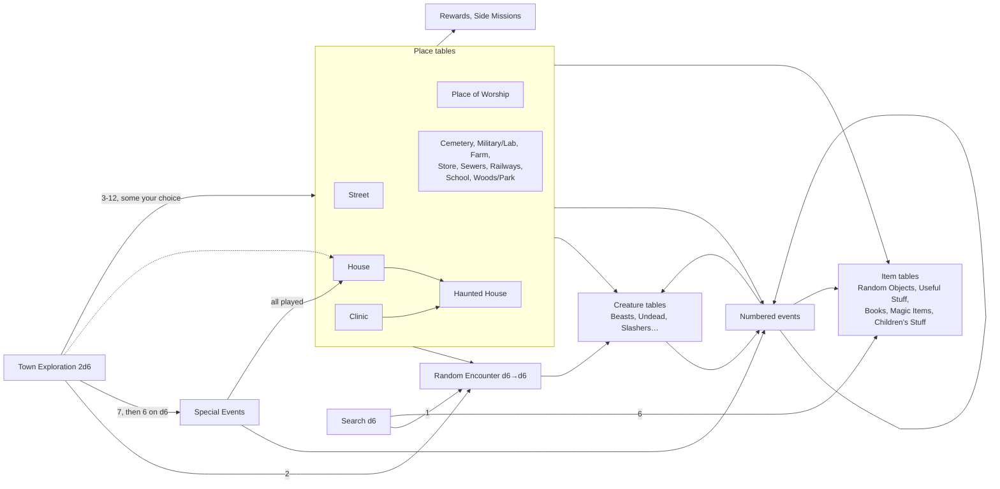
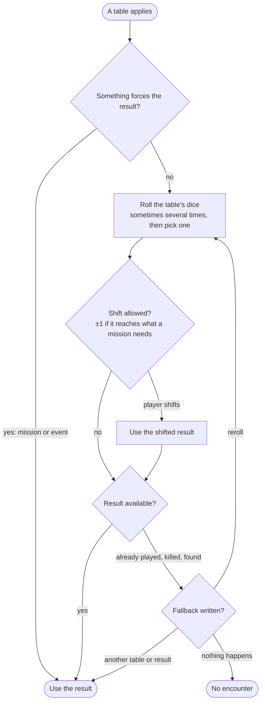
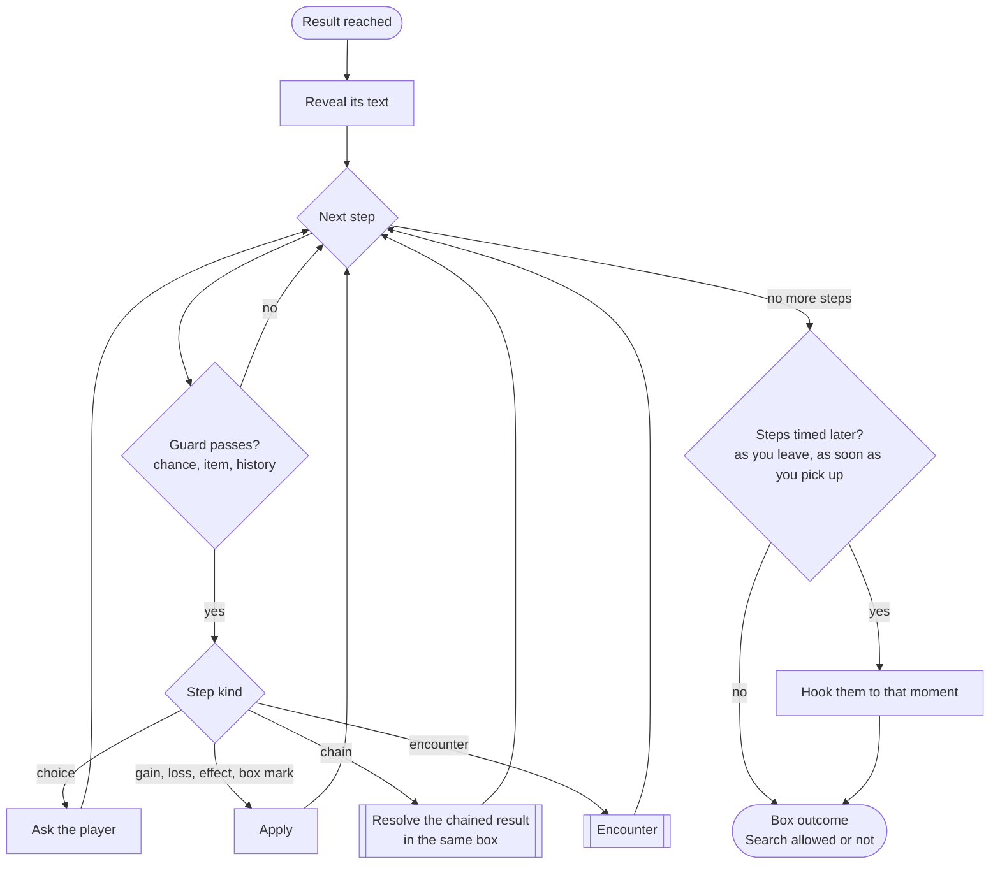
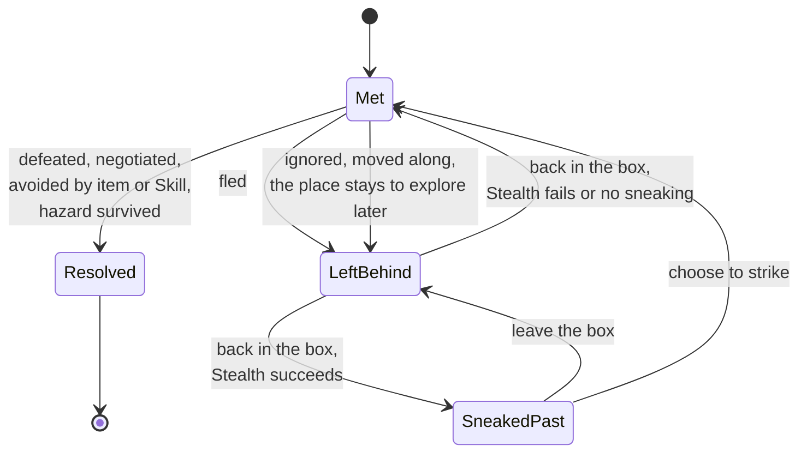
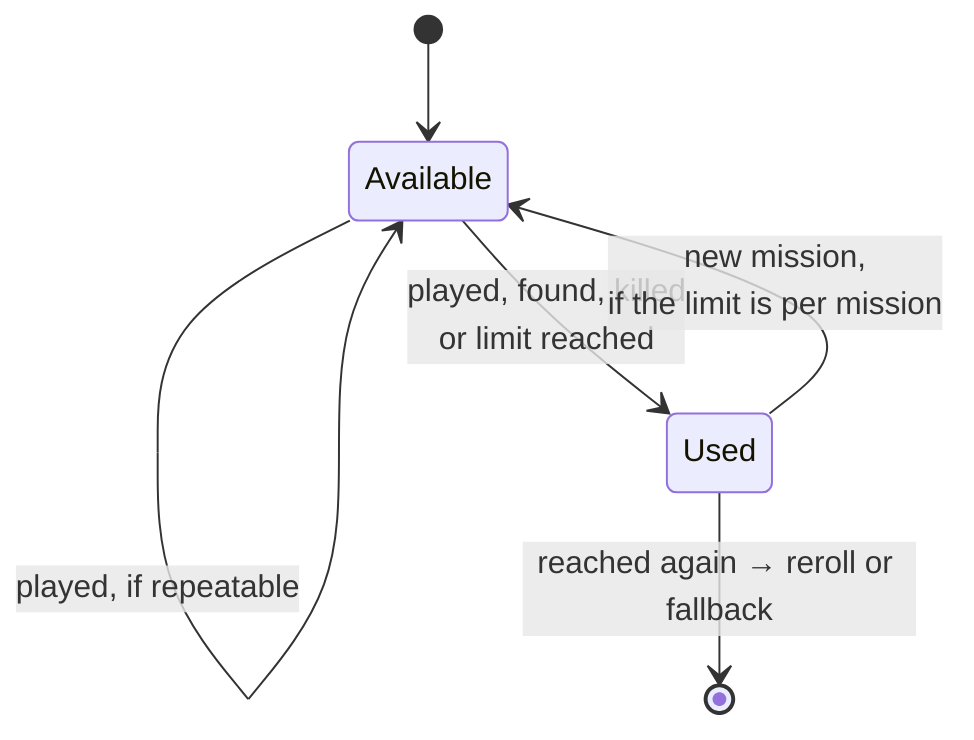
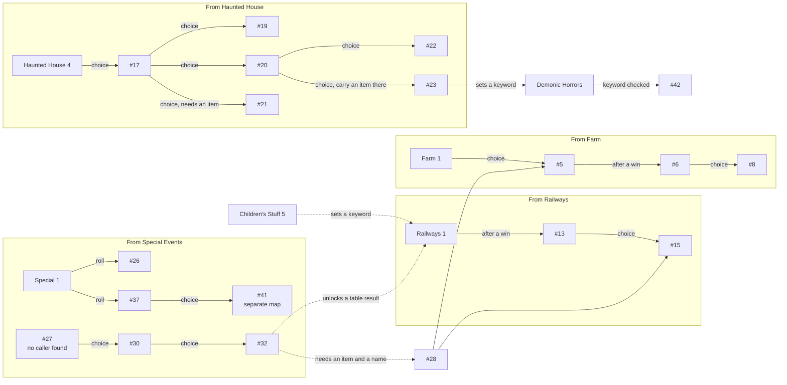
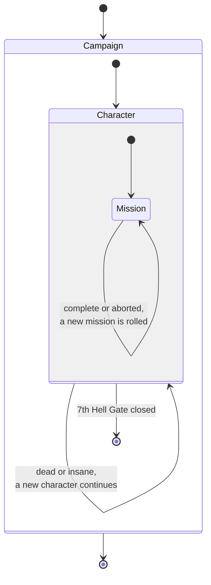

# Encounters and tables

How the content of a box is produced: tables, the results they give, how results chain, and what the game must remember afterwards. Words are defined in the [glossary](glossary.md). Sources: `5_how_the_game_works.md`, the tables under `gameRules/tables/`, `6_unique_events.md`. Interpretations go to [rulings](rulings.md); points still to decide are listed at the end.

## The table web

Which tables and events lead to which. Simplified: creature tables, item tables and most events are grouped.

- The content is a **graph, not a tree**: Haunted House is reached from House, Clinic and Flauros' deal; Random Encounter from Town Exploration, Search, Street; events call events.
- Some results **choose between tables** ("Store or Street, your choice"), or **roll to pick a table** (Railways 3: "1 Undead, 2 Beasts, 3-4 Slashers…").
- **Read only what applies**: "Whenever possible, do NOT read the content of the tables in advance. Read them only when they apply to you" (`5_4_town_exploration_table.md`). The engine reveals a text only when it is reached.

## Picking a result

A result is not always rolled. Missions, side missions and events can force it, shift it, or replace the roll.

- **Forced**: "the last box you visit will be a clinic" (Medical Supplies), "you can automatically get result 1 on the Railways table" (#32), a witch met by spending Clues (Destroy the Coven), a Hell Gate after 12+d6 new boxes (Close a Hell Gate). Hunting also replaces the box content.
- **Shifted**: ±1 on Town Exploration or an encounter table if it reaches the place or creature a side mission needs (`5_34_side_missions_table.md`), ±1 on Town Exploration to reach a Military Installation or Store (We Need Weapons).
- **Several rolls, pick one**: Search 6 ("roll 4 times… pick a single result"), Military 1 ("roll twice… choose the best"), Destroy the Coven reward ("roll three times and pick the best").

## What a result is made of

A result is a short script: steps in text order, some guarded, some offering choices. The building blocks found in the tables and events:

- **Encounter** — creatures (one or more groups), a hazard (a Save or a Defense roll), or people (helpful farmers, a priest, survivors, a shooter).
- **Chain** — roll another table, play event #N, or roll to pick a table.
- **Choice** — between tables, between outcomes, take it or leave it, explore or move along, fight or ignore.
- **Gate** — a step happens only on a chance (x in 6), if you own an item, Skill or keyword, depending on history (already played, killed, found), or up to a count (after played twice).
- **Gain or loss** — Life, Sanity, Food, XP, Clues, items, ammo, books, Skills, permanent stats.
- **Effect** — for N boxes or N encounters, until a condition (curses), permanent, a keyword on the play sheet, or deferred ("write down #25, read it later").
- **Box mark** — Safe House, Hell Gate, deconsecrated church, unique location (Rosen House).
- **Movement** — a forced move (#16, #42) or a separate map (#41 forest).
- **Mission** — a side mission given, mission progress (a dose found).

- **Encounters are not only creatures.** A falling debris Save, a warning shot, helpful farmers and a ghost asking for a ticket are encounters too.
- **Gates read the whole game**: the inventory (a jar, a train ticket, a shovel), Skills (Gate Arcane Skill), keywords (CLOWNFACE, SNOWY), history (event #10 "already played during this mission", Slashers killed in the campaign), and even what was read (the Necronomicon for #38).
- **Keywords are campaign flags** written on the play sheet: CLOWNFACE (Children's Stuff 5, checked by Railways 1), SNOWY (#23, checked by Demonic Horrors to play #42).

## Resolving a result

- **Steps run in text order**, unless a timing word moves them: "As you leave, the farm is attacked" (Farm 3), "When you leave, you are attacked" (Haunted House 3), "a random encounter that will happen as soon as you pick up any objects" (Store 6), "After rolling for encounters, you have a 2 in 6 chance of finding a sketchbook" (School 5).
- **A guard can depend on a choice**: the Food store's 3 in 6 encounter happens only "if you do so" (pick up Food), the bookstore's only "if you roll to find any books".
- **A chained result stays in the same box.** Its encounter is the box's encounter: what was fled there decides the Search.
- **Some steps loop**: climb until you get the object (Special Events 3), Save "until you break free" (#31), take down each corpse (Woods 6).
- **Search can be part of a result**: two Search rolls in the Psychiatric Ward (Clinic 5), a Search at +1 after the collapse (House 5), a Search with its own loot list (Farm 2). Search rolling a 1 starts a random encounter.

## An encounter's life

- A left-behind encounter keeps its full text: "If you avoid an encounter the text still applies and the monsters are still there" ([creator answers](creator-answers.md)). The zombies guarding the grenades: "The zombies (and the grenades) remain in the area if you leave" (Military 4).
- Some encounters have their own return rule instead: the cultists of the Desecrated Church ("Every time you come back to the church, roll a 2 in 6 chance that they are still there", #2), the sewer survivors (pay 1 Food or roll for the rats, #11).
- Some encounters cannot be left behind: Flying creatures and "You may not escape" (Eliza, Snowy Samuel, Pumpkin Head Demon).
- Search: "If you flee from an encounter, you may NOT Search that area" (`5_4_town_exploration_table.md`). Ignoring and moving along block the Search too ([rulings](rulings.md)).

## Things that run out

Many results can only happen a limited number of times. The limit is usually written **where the result is referenced**, not on the event itself: Street 6 says "Play event #3. If you already played that, roll on the Random Encounter table".

| Content | Limit | Scope | When reached again | Source |
| --- | --- | --- | --- | --- |
| Special Events | once | campaign ("in the game") | reroll; all played → House | `5_19_special_events_table.md` |
| Slashers | until killed | campaign | reroll; all killed → no encounter (table text: "count it as a no encounter") | `5_2`, `5_24` |
| Unique Vampires, Unique Zombies | until killed | campaign | reroll; all killed → no encounter | `5_2_random_encounters_table.md` |
| Good Doctor (#29) | until killed | campaign | Unique Zombies table | `6_unique_events.md` |
| Pighead (#5) | until killed | campaign | ignore the event | `6_unique_events.md` |
| Rosen House | once | campaign | reroll; location stays on the map | Haunted House 4 |
| Children's Stuff | once each | mission | reroll; all found → Useful Stuff or Random Object | `5_17_childrens_stuff_table.md` |
| Fluid needle | once | mission | reroll | Military 5 |
| Events #9, #10 | once | mission | keep moving / Beasts | Farm 4, Farm 6 |
| Werewolf, Hangman's Tree | twice | campaign ("in a game") | Beasts | Woods 1, 6 |
| Other numbered events (#1, #3…) | once | campaign (not said) | fallback roll | House 6, Street 6 |
| Graffiti Clue | once | campaign | no effect | Railways 4 |
| Black mirror rituals (#28) | once per demon name | campaign | no effect | `6_unique_events.md` |
| Walrus side mission | once | campaign | reroll | Side Missions 6 |
| Event #2, Hand of Glory (#33) | none | — | play again | `6_unique_events.md` |

- Two scopes: **mission** and **campaign**. "In the game" and unstated limits count as campaign ([rulings](rulings.md)).
- The name "Unique Events" does not mean once: #2 says "This is not a unique event", and most events state no limit at all.

## Unique Events as stories

Numbered events form short story chains, held together by choices, items and keywords found earlier. Spoiler-free: numbers and how they connect, no plot.

- **Story state lives in the inventory and the play sheet**: an item carried to a place (#23), an item kept until another one is found (#36), a ticket that opens an event (#24), names learned for a ritual (#28).
- **Deferred events**: #18 tells you to write down #25 and read it only when a later moment happens (a hit in combat). An event can be armed now and triggered later.
- **Orphan events**: #7, #18, #27 and #39 are referenced nowhere in the extracted text. Lost in the OCR, or missing from the book.
- **A curse can watch events**: #21 can give a curse that costs Sanity "every time you play through a numbered event".

## What the game remembers

What the game remembers is tied to lifetimes, and the lifetimes nest: a campaign outlives its characters, a character outlives its missions. Leaving a level forgets what it held.

| Level | Forgotten when | What it remembers | Examples |
| --- | --- | --- | --- |
| Campaign | never, it is the game | the map and its boxes, the box counter, content used for good, creatures killed, keywords about the town | Special Events, Slashers, Rosen House, rituals done, SNOWY |
| Character | death or insanity | Food, Clues, stash, items, Skills, XP, Injuries, Scars, curses, what was read, keywords about the person | Necronomicon read, cursed blade, deferred #25, CLOWNFACE |
| Mission | a new mission is rolled | content used this mission, mission progress | Children's Stuff found, #9 and #10 played, doses found |

**Which level a fact belongs to: does it describe the town or the person?** What happened to the town (events played, creatures killed, places found, Hell Gates closed) belongs to the campaign. What the character carries, knows or suffers (Clues, Food, items, Skills, curses, books read, names learned) belongs to the character. What serves the current goal belongs to the mission. This is our design principle, not a book rule. What counts is who a thing belongs to, not where it lies: the stash and discarded items lie in a box but disappear with the character ([creator answers](creator-answers.md), [rulings](rulings.md)).

**One event can write to several levels.** Railways 4: "Gain 1 Clue the first time you find this in the campaign." The campaign remembers the event happened; the Clue goes to the character. If the character dies, the new one loses the Clue and cannot get it again.

**Boxes** are not a lifetime: they are the campaign's map. Each box remembers its places (every place table rolled in it), left-behind encounters, Searched, marks (Safe House, Hell Gate, deconsecrated church, Rosen House) and every-visit rules (cultists 2 in 6, religious symbol "every time you visit"). One box memory crosses levels: the **stash** sits in a box but dies with the character ([creator answers](creator-answers.md)).

- **A box can change its nature later**: Flauros deletes two Safe Houses and a church ("Roll on the Haunted Houses table if you visit those areas", #28), a failed fight makes a deconsecrated church (Place of Worship 2).
- **Not everything happens on the grid**: #16 moves you 1 or 2 boxes, #42 can force you into a neighbouring box, #41 opens a separate forest map.

## What this reveals

- **Results are scripts.** A few step kinds (encounter, chain, choice, gate, gain, effect, box mark, movement) cover the content read so far, but steps mix freely and many results carry one unique rule. This is the main input for D1 (rules content format).
- **The game needs a history.** Gates and exhaustion read what happened before. The memory follows nested lifetimes (campaign, character, mission), so one record of "what happened" (played, found, killed, keywords) per level could serve them all.
- **Game moments again.** "As you leave", "as soon as you pick up", "every time you visit", "as soon as your blade hits", "every time you play a numbered event": the effects and game moments topic must cover them.
- **Encounters are wider than combat.** The combat model covers creature groups; hazards and people need the same lifecycle (met, resolved, left behind) without a fight.

## Decided

The questions this topic raised are settled in [rulings](rulings.md#encounters): ignoring and moving along block the Search, limits and numbered events are campaign-wide unless stated, SNOWY is a campaign keyword, a box counts as every place table rolled in it.
