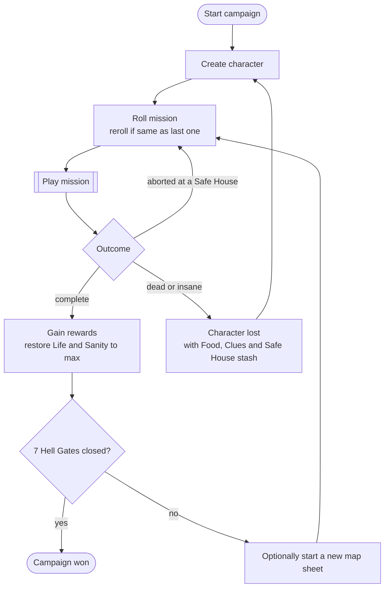
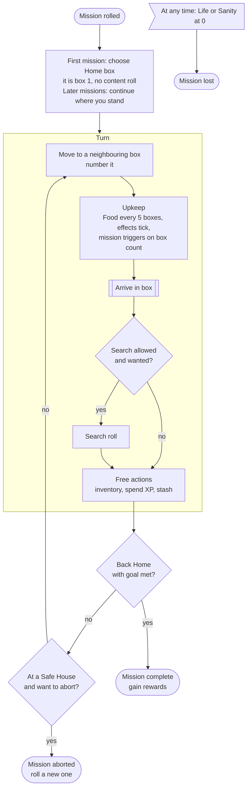
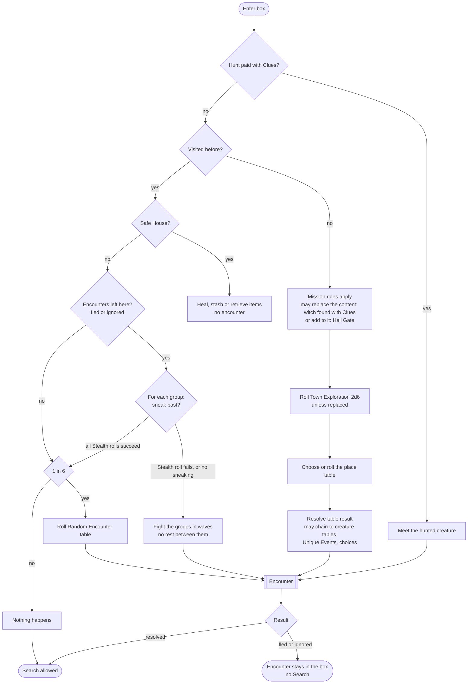

# Game flow

How a game runs, from campaign down to a single box. Words are defined in the [glossary](glossary.md).

## 1. Campaign

The campaign is one continuous walk through one town. Missions are goals layered on top of it: the map, the box counter, Food and Clues all carry on from one mission to the next ([creator answers](creator-answers.md)).

Carried between missions: map, box counter, Food, Clues, Skills, XP, items, Injuries, Scars. Reset: Life and Sanity (healed to max).

Open: after a death, does the new character keep the same map? Stash, Food and Clues are lost, the map is not mentioned.

## 2. Mission

The character must leave a box to play it again: no staying in place to heal twice. Home is not a Safe House.

Search is allowed when the encounter was not fled or ignored ([rulings](rulings.md)) and the box was not Searched yet. A Safe House follows the same rule as any box. Libraries can be Searched again for 1 book or 1 Clue.

## 3. Arriving in a box

Safe Houses, and what happens when one stops being one, are detailed in [Safe Houses](safe-houses.md).

A box can hold several encounters left behind (fled or ignored). Each keeps its full text: an ignored zombie horde with special loot is the same horde when you come back.

Mission rules that say "every time you visit" a place apply to visited boxes too (e.g. Medical Supplies at a Clinic).

Hunting applies to any box, visited or not: a creature hunting you does not care whether you have been there before (our ruling, see [rulings](rulings.md)).

## What the flows reveal

- **Everything is a roll vs L or a table roll.** Two mechanisms carry most of the game.
- **Modifiers come from everywhere**: Skills, items, Injuries, Scars, the mission, temporary effects. A roll must collect them all.
- **Rules react to moments** ("every 5 boxes", "every time you visit a Clinic box", "after 12+d6 boxes", "in the last 5 locations"). Missions are mostly made of such reactions. We need a notion of game moments that rules can hook into.
- **The player chooses constantly** ("your choice", "you may ignore them", "you may explore it or move along"). The engine asks, the interface answers.
- **The box number is the clock**, and it runs for the whole campaign, not per mission. Durations and triggers count boxes. Some count only new boxes (the Hell Gate deadline).
- **The campaign is the real game state.** A mission is a goal plus its rules, swapped in and out of a continuous campaign. Saving a game means saving the campaign.
- **Boxes remember things**: content, encounters left behind, Searched, Safe House, stash. The map is not just geometry.
