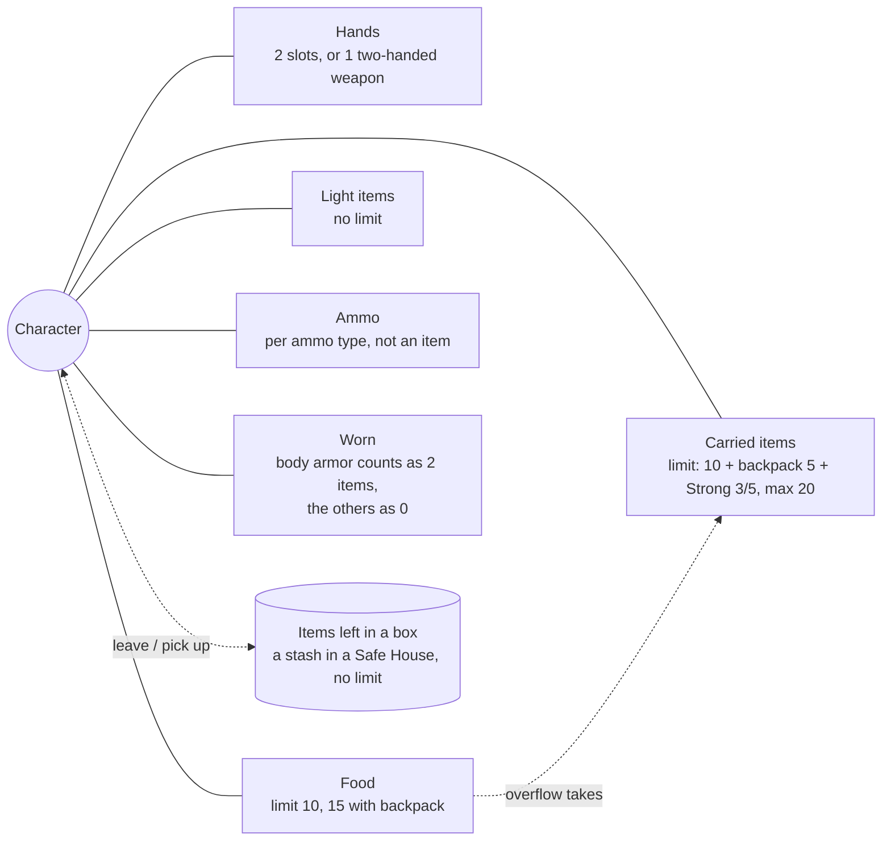
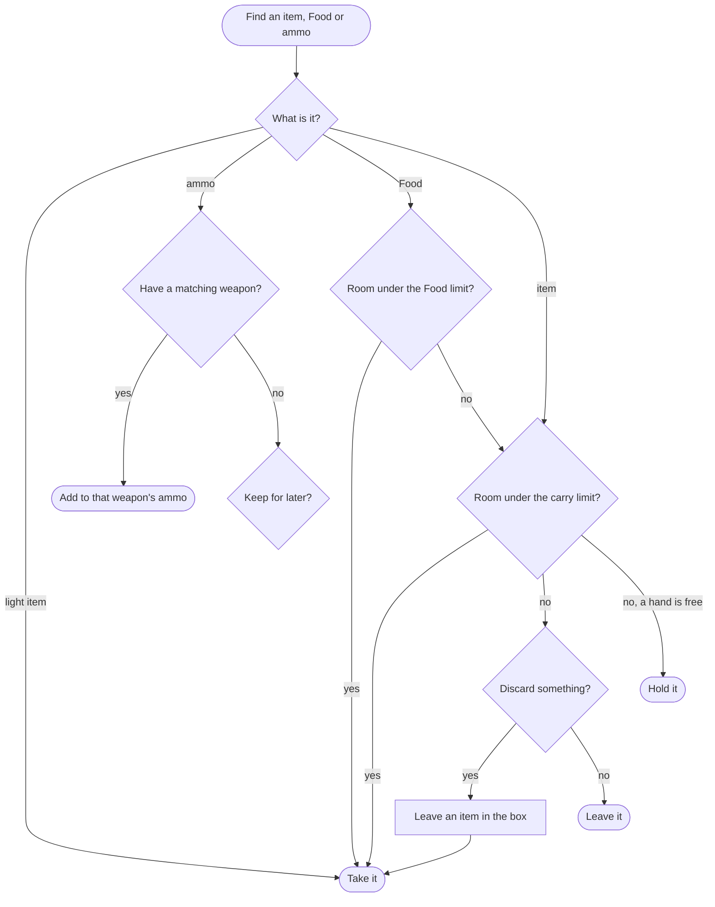
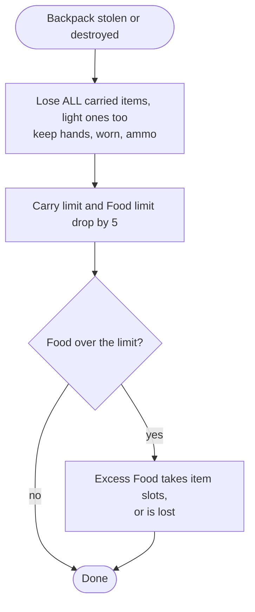

# Inventory

What the character carries, where, and what happens when limits are hit. Words are defined in the [glossary](glossary.md).

## Where things are

- **Hands** hold what is ready to use: usually the weapon. Changing weapons is free before a combat, 1 Action during it.
- **Carried items** count against the carry limit. Bundles count as one item: d6 jars of cat food, several stakes or candles, medical supplies, grenades on a bandolier.
- **Food** has its own limit. Extra Food beyond it takes 1 item slot per point.
- **Light items** (negligible weight) never count: small bell, holy symbol, scarab.
- **Ammo** is counted per ammo type (bullets, rifle bullets, bolts, arrows, shells), each used by its weapon kind: two pistols share bullets, a pistol and a rifle do not. Not an item, no slot.
- **Worn** items are the ones whose text says they can be worn (clothes, helmet, gas mask, leather jacket, amulets, body armor); worn, most take no slot (body armor 2). One set of clothes at a time. The backpack is carried but takes no slot.

Every item takes 1 slot unless its text says otherwise; a bundle (d6 jars of cat food) takes its slots once, whatever its count.

## Picking something up

## Losing the backpack

## Leaving items

- Items can be left in any box and picked up on a later visit. In a box that is not a Safe House, they roll d6 on every return: on 1-3 they are all gone.
- In a Safe House they are a stash, any number, safe as long as the box stays a Safe House.
- When it stops being one, the stash may be stolen: see [Safe Houses](safe-houses.md).
- When the character dies, every item left anywhere is lost.

## Items are effects too

Items fit the [effect](character.md) model: Charisma +1 (flowers), Defense +1 vs mummies (scarab), XP cost -1 for Martial Arts (handbook), carry limit +5 (backpack). They add two things Skills did not need:

- **A lifetime.** Effects can be permanent, last N boxes, last N uses ("your next 3 rolls"), last until an event ("after an encounter with a mummy"), or be spent by sacrificing the item (toy, dog toy, flowers).
- **Reactions.** Some effects react to a moment rather than change a roll: body armor and helmet roll every time you take Damage, the stuffed bird takes a bird-demon's first attack. This is the same "game moments" idea found in the [game flow](game-flow.md).

Items can also have their own Life (body armor 4, helmet 3) and their own trainable upgrade (the antique flail: 2 XP to stop hitting yourself, 2 more for Expert). Items are richer than a name and a weight.

## Rulings

Hand slots are extra, Strong does not raise the Food limit, left items may vanish (d6, 1-3, on every return), ammo is kept per type and without a weapon, a lost backpack takes light items too, wearable items are the ones whose text says so. See [rulings](rulings.md#inventory).
