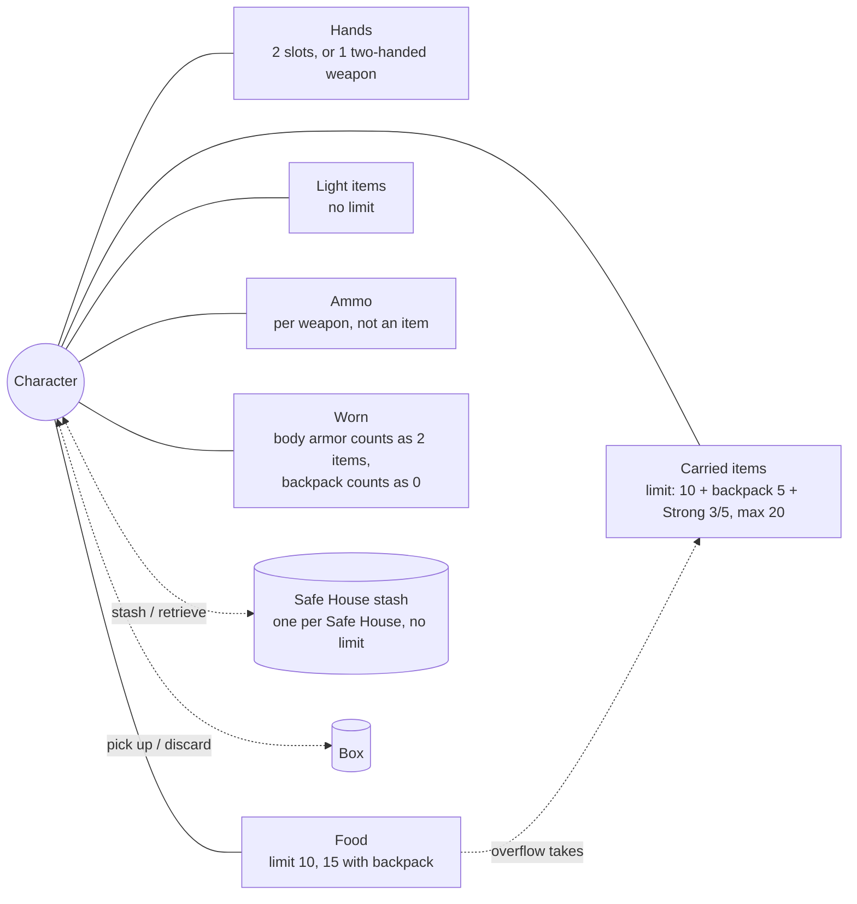
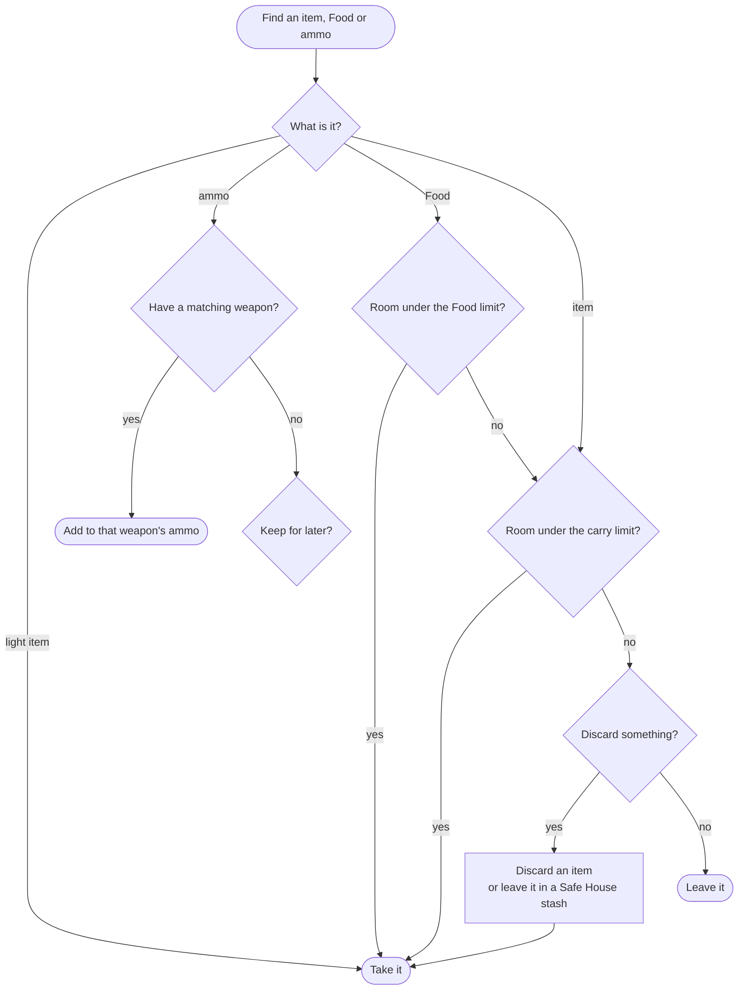
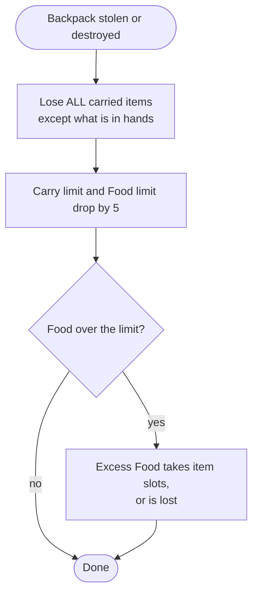

# Inventory

What the character carries, where, and what happens when limits are hit. Words are defined in the [glossary](glossary.md).

## Where things are

- **Hands** hold what is ready to use: usually the weapon. Changing weapons is free before a combat, 1 Action during it.
- **Carried items** count against the carry limit. Bundles count as one item: d6 jars of cat food, several stakes or candles, medical supplies, grenades on a bandolier.
- **Food** has its own limit. Extra Food beyond it takes 1 item slot per point.
- **Light items** (negligible weight) never count: small bell, holy symbol, scarab.
- **Ammo** belongs to a weapon type (pistol bullets, rifle bullets, bolts, arrows, shells). Not shared between different weapons, not an item.

## Picking something up

## Losing the backpack

## Stash

- Items can be left in any Safe House, any number, and retrieved on a later visit. They are safe as long as the box stays a Safe House.
- When it stops being one, the stash may be stolen: see [Safe Houses](safe-houses.md).
- When the character dies, every stash is lost.

## Items are effects too

Items fit the [effect](character.md) model: Charisma +1 (flowers), Defense +1 vs mummies (scarab), XP cost -1 for Martial Arts (handbook), carry limit +5 (backpack). They add two things Skills did not need:

- **A lifetime.** Effects can be permanent, last N boxes, last N uses ("your next 3 rolls"), last until an event ("after an encounter with a mummy"), or be spent by sacrificing the item (toy, dog toy, flowers).
- **Reactions.** Some effects react to a moment rather than change a roll: body armor and helmet roll every time you take Damage, the stuffed bird takes a bird-demon's first attack. This is the same "game moments" idea found in the [game flow](game-flow.md).

Items can also have their own Life (body armor 4, helmet 3) and their own trainable upgrade (the antique flail: 2 XP to stop hitting yourself, 2 more for Expert). Items are richer than a name and a weight.

## Rulings

Hand slots are extra, Strong does not raise the Food limit, discarded items may vanish (d6, 1-3), ammo without a weapon is kept. See [rulings](rulings.md).
