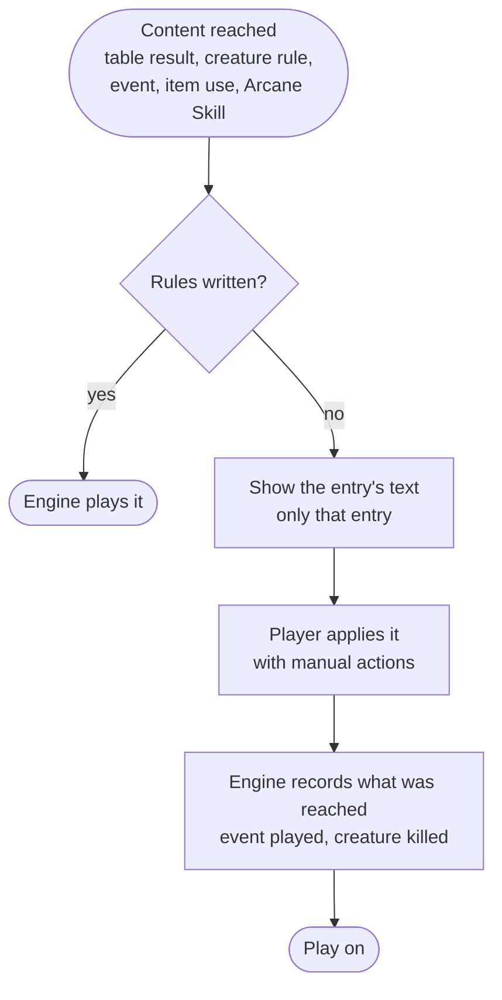

# MVP scope

What the first versions of the game contain, and what happens with the rest of the book until it is written. Words are defined in the [glossary](glossary.md). Decided in the MVP scope session (was D6).

## Goal

The MVP is done when **a whole campaign can be played** in the terminal. It comes in two steps:

1. **First playable: Bring Home the Bacon.** One mission from character creation to the end: back Home with the Food, dead, or insane.
2. **Campaign playable: Close a Hell Gate.** Arcane Skills, books, and missions played one after another until 7 Hell Gates are closed.

The aim is a working version as fast as possible that stays easy to extend.

## Principle: the whole model, thin content

- **The engine follows the design**: rolls with tags, effects and moments, result scripts, what the game remembers, combat, the map. Each part is written only as far as the content of the current step needs it, but in the shape the design describes, so later content fits without reworking the engine.
- **Content is written as little as possible.** Whatever is not written yet goes through one fallback, **book mode**. Content then grows one table at a time, each piece replacing part of book mode.
- **The content web cannot be cut by table.** Street, Store and Farm alone lead to 7 of the 12 creature tables, and the Random Encounter table to all of them. Whatever is left out is one or two rolls away from what is in, so the fallback matters more than the slice.

## Book mode

- **The engine shows the text of the entry reached**, and only that entry: "Read them only when they apply to you" (`5_4_town_exploration_table.md`).
- **The player applies it with manual actions**:
  - gain or lose Life, Sanity, Food, XP or Clues;
  - add or remove an item;
  - go to a table or a numbered event ("roll on the Undead table", "play event #1"): the engine rolls it, a written entry plays itself, an unwritten one is shown in book mode;
  - make a roll vs L ("an L4 agility Save"): the player gives the roll type and L, the engine adds the modifiers from Skills and items;
  - make a Search roll, with the bonus the text gives;
  - fight a creature;
  - mark the box as a Safe House (step 2: as a Hell Gate);
  - write or remove a note.

  Each is an engine action that already exists, opened to the player. They double as a test console.
- **Where they are offered.** After an entry the engine cannot read, before the player says where its text leads; the menu comes back after each one, so the whole entry is applied before leaving it. The ones about the character (gain, lose, a roll vs L, notes) are also a free action, "apply an effect", for a turn where no entry is shown: a lasting effect noted earlier still has to be applied. Marking a Safe House is about the town, so only the entry that gives it offers it. Search is a free action of its own.
- **Notes keep track of what the engine cannot.** A note is plain text the engine stores and shows but never reads: a lasting effect ("lose 1 Life each box, for 2 boxes") or a modifier ("cursed: -1 to Search") from an entry the engine cannot play. Each note keeps the box number it was written at, so the player can tell when an effect "for N boxes" ends. They belong to the character. With notes, the Search asks the modifier they give before rolling. Written content does not need them: its effects are tracked by the engine (E7, E8). They go away entirely only when all content is written; E8 considers manual effects the engine applies by itself, which could replace most of them.
- **Death is checked once the entry is applied.** At 0 Life or Sanity the entry offers only the manual actions and "nowhere else": the player applies the rest of its text (a heal may bring the character back), then the chain stops and the game ends if the character is still at 0.
- **Manual actions go through the rules**, exactly as written content would: losing Life offers an Injury and kills at 0, healing stops at max, Food over the limit asks for an item slot, reactions fire. A loss stops at 0: only what the character has can be lost. They are game operations, not edits of the numbers, so book mode can never put the game in a state the rules forbid.
- **The engine keeps every number.** Stats, inventory, Food, ammo and the box counter stay in the engine in book mode too; only what the entry does is left to the player.
- **Fights are always run by the engine.** "Fight a creature" takes a creature from the creature tables, or stats typed from the text ("d6+3 sewer people, L2, 1 Life, Damage 1"), and the engine runs the combat.
- **One entry can be half written.** A creature's stats can be played by the engine while its special rule is shown as text; an item can sit in the inventory with its weight while its use is shown as text.
- **Manual actions stay open during a fight** while a special rule's text is on screen, with one more action: creature Life up or down. The player rolls and applies what the rule says (the alligator: 2 in 6 that a hit bounces off).
- **What was reached is still recorded**, so limits and fallbacks keep working: an event played in book mode is played, a creature killed in a book-mode fight is killed.
- **Missions never use book mode.** A mission's rules last the whole mission, which manual actions cannot follow. The mission is rolled among the written ones only.

### Where the text comes from

- **The rules text is copied into YAML files.** Each table, entry, creature, item, event and Skill gets a stable ID, its dice and entries, and its text as written in the book. While copying, OCR damage is fixed against the original PDFs in `origin_rules/`, and page references become table names. Files, IDs and the shape of a table: [rules text in YAML](../docs/content.md).
- **Behaviour stays in Python**, keyed by the same ID. YAML holds no rules logic, so no rules language is invented ([D1](../Readme.md#deferred)). Whether plain data (creature stats, item weight, Skill XP cost) also goes into YAML is decided when the engine writes its first content (E6 in the [roadmap](../Readme.md#milestone-6--step-1-bring-home-the-bacon)).
- **The Markdown in `gameRules/` stays** as the readable copy. The YAML is the copy the engine reads. Both are fixed together.
- **Everything is copied before step 1 is playable**: every table, event, item and Skill, in batches ordered by when the engine needs them ([Milestone 3](../Readme.md#milestone-3--rules-text-in-yaml)). This replaces the Markdown-only cleanup. Until an entry is copied, book mode shows its file and entry number instead.
- The same text can later feed a narrator ([D8](../Readme.md#deferred)).

## Step 1: Bring Home the Bacon

### Engine

From the design, as far as this step's content needs:

- Dice, rolls vs L with tags, modifiers collected from effects ([rolls](rolls.md), [effects](effects.md)).
- Effects and moments: holders, kinds, lifetimes, reactions ([effects](effects.md)).
- Character: Life, Sanity, the 22 non-Arcane Skills (Basic and Expert), **spending XP at any time**, Food, Clues, Injuries and Mental Scars, death and insanity ([character](character.md)).
- Inventory: hands, carry and Food limits, backpack, ammo, discarding, stash ([inventory](inventory.md)).
- Character creation: 2 Skills, 3 points, random weapon and knife, Random Object and Useful Stuff, d6 Food.
- Town map, moves, box numbers, Food every 5 boxes ([town map](town-map.md)).
- Arriving in a box, encounters and their life, left-behind encounters, Search and Clues ([game flow](game-flow.md), [encounters](encounters.md)).
- Tables and result scripts: chains, choices, gates, limits and fallbacks ([encounters](encounters.md)).
- Combat, Escape, Stealth, Charisma, waves ([combat](combat.md)).
- Safe Houses ([Safe Houses](safe-houses.md)).
- Missions as holders of effects, with goal and rewards. Aborting comes with step 2: with one mission written, there is no other mission to roll.
- Book mode and its manual actions.
- The terminal game loop.

### Content written

| Content | Written | Rest in book mode |
| --- | --- | --- |
| Missions | Bring Home the Bacon | the other five are not rolled |
| Exploration | Town Exploration, Random Encounter, Search | |
| Places | Street, Store, Farm (the mission's places) | the other 11 place tables, Special Events |
| Creatures | the stats of every creature in the 12 creature tables | special rules, until written |
| Creation | Random Weapon table, weapons from the weapon summary, Random Objects, Useful Stuff | item uses that need a mechanism not in this step |
| Skills | the 22 non-Arcane Skills | |
| Harm | Injury and Insanity tables | |
| Everything else | | events, side missions, rewards, books, magic items, Children's Stuff |

Every Skill is written: almost all are roll modifiers, stat modifiers or rule parameters, cheap once effects exist.

## Step 2: Close a Hell Gate

- **Close a Hell Gate mission**: a Hell Gate after 12+d6 new boxes and another in the 30th box if none was found, the closing roll, Hell Gates closable during any mission.
- **Arcane Skills**: learning works for all 11 (prerequisites, XP cost). **Gate** is written; the other 10 can be learned and their effects use book mode until written.
- **Books**: the Random Books table, reading takes d3 boxes of time, each book once per game. Reading and the Arcane Skills it unlocks are written; other book effects use book mode until written.
- **Campaign play**: missions one after another (rewards, Life and Sanity back to max, reroll the same mission), abort at a Safe House, a new character after death or insanity continues the campaign without the previous one's Food, Clues and stash, the campaign is won when the 7th Hell Gate is closed ([game flow](game-flow.md)).
- With two missions written, "reroll if same as last one" makes them alternate.

### To decide when step 2 starts

- Starting a new map sheet after a mission before the current one is full ([town map](town-map.md#open)).
- Whether a new character after a death keeps the same map ([game flow](game-flow.md)).
- Whether closing a Hell Gate is a Will roll (the Gate Skill) or a Magic roll (the mission and the Sewers table).

## After the MVP

- **Save and resume.** The game state should refer to content by ID, never hold code, so saving stays easy to add.
- **Hunting with Clues**, and the missions that need it: Predator and Prey, Destroy the Coven. Medical Supplies and We Need Weapons come as content.
- **Switchable rule options.** The MVP plays the default [rulings](rulings.md).
- **Optional rules** and random Skill generation.
- **The forest side map of #41**: its size, entry and exit are decided when #41 is written. The model already holds side maps ([town map](town-map.md)).
- **All other content** (place tables, events, side missions, rewards, magic items, books, Arcane Skill effects) can be written at any time, each piece replacing part of book mode.

## Decide when implementing

- Which item uses are written in step 1 (weapons, ammo, Food items, first aid kit, backpack and armor need step 1 mechanisms; most others can wait).
- A free note on the box or the character, for book-mode effects that last ("for the next 3 boxes", a curse).
- ~~The YAML file layout and ID scheme~~: decided in R1, see [rules text in YAML](../docs/content.md).

## Order of work

The [roadmap](../Readme.md#roadmap) builds a **skeleton** first: dice, game state, map and time, the engine/interface protocol, book mode. After those five tasks a whole game can be walked in book mode, and every later task replaces part of book mode, so it can be tried in the game straight away. Each later task writes an engine part together with the content that uses it (combat with the creature stats and weapons, for example).
