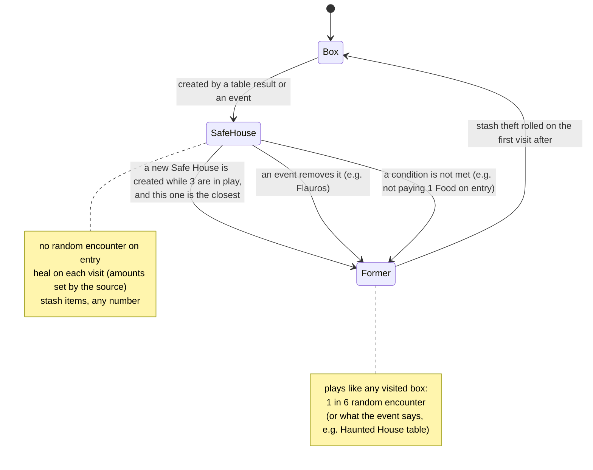
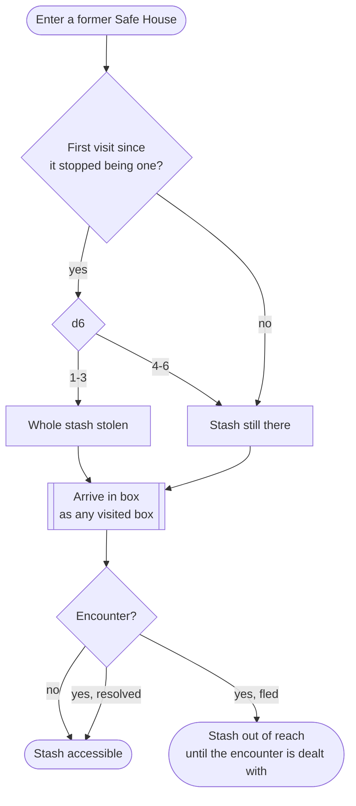

# Safe Houses

The book has no Safe House section: the rules are spread over place tables, the equipment rules, the escape rules, events and creatures. This page gathers them. Words are defined in the [glossary](glossary.md).

## Lifecycle

- **Max 3 in play.** Creating a 4th turns the closest one (counted in boxes, ties broken randomly) into a former Safe House.
- **Created by** the House, Cemetery and Clinic tables (Safe House result), Street (a nice place to hide), Place of Worship (optional), Woods/Park (safe area), and events (e.g. a survivor lets you in).
- **Each source sets its own healing per visit**: House 2 Sanity and 3 Life, Cemetery and Clinic 2 Sanity and 4 Life, Place of Worship 3 Sanity and 2 Life, Woods/Park 1 Life or 1 Sanity. A Safe House is a box status plus the healing its source gave it.
- **Some are conditional**: the survivor's Safe House holds only while you pay 1 Food on each entry.
- **Home is not a Safe House.**

## Arriving in a former Safe House with a stash

## Safe Houses elsewhere in the rules

- **Escape** to a neighbouring Safe House: no random encounter roll there.
- **A cure point**: infection, disease and some wounds last "until you reach a Safe House" (Sewers infection, Upyr disease, Maraya's eye wound).
- **Missions**: Predator and Prey can end at any Safe House, Bring Home the Bacon lets you stash items there, side missions escort people to one, and missions are aborted at one.
- **Absent Mindedness** (Mental Scar): a missing tool was left at a Safe House if one is in play, otherwise lost.
- **Character death**: every stash is lost.

## Open

- The Street table says "if it is the **third** Safe House in play, the closest one is no longer a Safe House", the other tables say "if there are **already 3**". Likely an editing slip: we follow "max 3".
- The Street Safe House does not say how much it heals on later visits.
