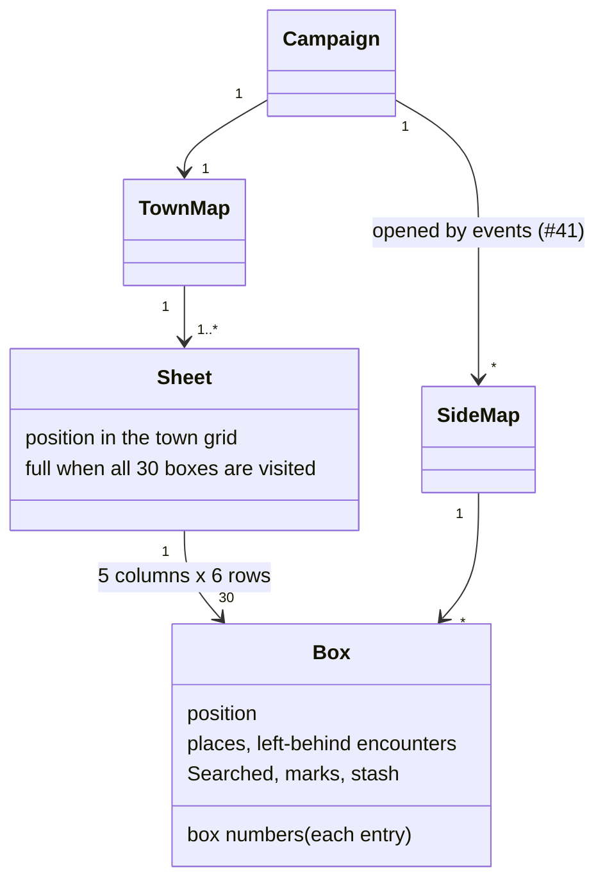
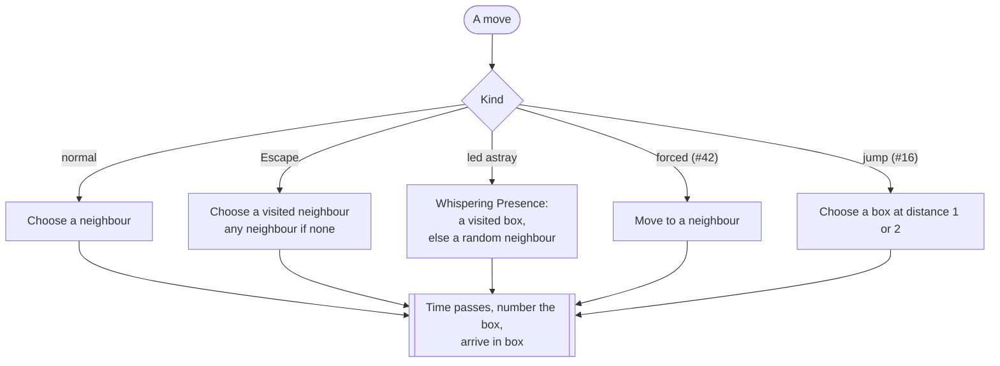

# Town map

The shape of the town: sheets, boxes, neighbours, distances and the moves that do not follow the usual step. What a box remembers (places, left-behind encounters, marks) is in [encounters](encounters.md#what-the-game-remembers). Words are defined in the [glossary](glossary.md). Sources: `5_how_the_game_works.md`, `1_1_main_rules.md`, the [town map sheet](../gameRules/13_town_map.md), the [creator answers](creator-answers.md). Interpretations go to [rulings](rulings.md#map).

## Structure



- **The town is one grid.** A sheet is a 5×6 block of it (5 columns, 6 rows), as printed. Sheets are added "next to the previous ones" (`1_1_main_rules.md`): a new sheet is placed against a side of an existing sheet, and the player picks which side. Boxes on either side of a seam are neighbours, so moves and distances work across sheets as if the town had been drawn on one large page ([rulings](rulings.md#map)).
- **A sheet's open edges are walls until it is full.** "If you visit all the boxes on a sheet and you haven't completed your mission yet, just attach a new paper sheet" (`5_how_the_game_works.md`). Once all 30 boxes are visited, the player may attach a new sheet and walk onto it.
- **A new sheet may also be started after a mission** ([creator answers](creator-answers.md)), even if the current one is not full. Where the character goes then is open (see below).
- **Home is any box** of the first sheet, chosen by the player. It is box 1 and has no content roll ([game flow](game-flow.md)).
- **Side maps** are separate grids outside the town: #41 asks to "prepare a separate map diagram" for a forest. They use the same boxes and neighbours, but are not attached to the town grid. Their size and how you enter and leave them are decided with the MVP scope.

## Neighbours and distance

```
+----+----+----+
| 1  | 1  | 1  |      Neighbours: the 8 boxes around,
+----+----+----+      diagonals included.
| 1  | ** | 1  |      Fewer on an edge or a corner
+----+----+----+      (a corner of the first sheet has 3).
| 1  | 1  | 1  |
+----+----+----+

+----+----+----+----+
| 0  | 1  | 2  | 3  |  Distance from the top-left box:
+----+----+----+----+  the fewest moves to get there,
| 1  | 1  | 2  | 3  |  a diagonal step counting as 1.
+----+----+----+----+
| 2  | 2  | 2  | 3  |
+----+----+----+----+
```

- **Neighbours** are the boxes sharing a side or a corner: "you may move diagonally if you wish".
- **Distance** is the fewest moves between two boxes, diagonals included: the larger of the column gap and the row gap. The book counts "the number of boxes on the town map that you should cross to reach that location" ([rulings](rulings.md#map)). Inside one sheet, or sheets side by side, the walk always matches this count.
- **Distance is used by**: the closest Safe House losing its status when a 4th is created ([Safe Houses](safe-houses.md)), the "most distant unrevealed box" of the escort side mission (Side Missions 2), and #16 ("1 or 2 boxes from your previous location").

## Moves



Every move takes one box of time and enters one box: the box gets the next number and the [arrival flow](game-flow.md#3-arriving-in-a-box) runs, unless the move's own text replaces it. The text usually does: Escape rolls a 1 in 6 random encounter "unless the box you moved to is a Safe House", the Whispering Presence rolls 2 in 6 in a visited box, #42 sets its own encounter.

A box can be numbered more than once: each entry writes a new number in it (the paper sheet keeps only the circle, the engine keeps every number). The box number is the clock, it never resets ([glossary](glossary.md)).

## What the map reveals

- **Positions are coordinates in one grid.** A box needs a position (column, row) in the town; the sheet it belongs to follows from it. Neighbours and distance are computed, never stored.
- **The map grows only when a sheet is full**, or after a mission. Until then, the 30 boxes of the current sheet are the whole reachable town.
- **Moves are a small family**: a normal step, plus a few moves with a restricted or wider choice of target (Escape, led astray, forced, jump). Each is a choice of box followed by the same arrival.
- **Side maps are maps too**: a campaign holds the town and any side maps opened by events, so "the map" in rules text means the map the character stands on.

## Open

- **Starting a new sheet after a mission** before the current one is full: does the character walk onto it from an edge, or start anywhere on it? Matters only for campaign play.
- **The forest map of #41**: size, how you enter and leave it, and whether box numbers and Food run there. Decided with the MVP scope.
- **#16's jump**: whether the box in between counts as crossed (numbered, encounter roll) or skipped, and whether the jump takes 1 box of time or 2.
- **"Most distant unrevealed box"** (Side Missions 2): on the current sheet or the whole town, and what happens if every box of the current sheet is revealed.
- **Distance around a missing sheet**: when sheets form an L, the straight count can cross a spot with no sheet, so the real walk is longer. Count the grid or the walk? Rare, and only matters for the closest Safe House.
- **Ties when several boxes are at the same distance** for the escort side mission. The Safe House rules break ties randomly; the same rule would fit.
