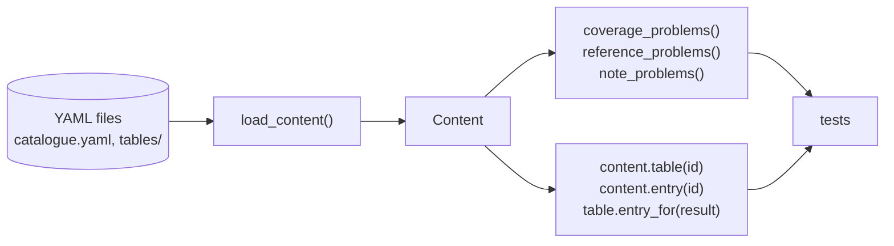
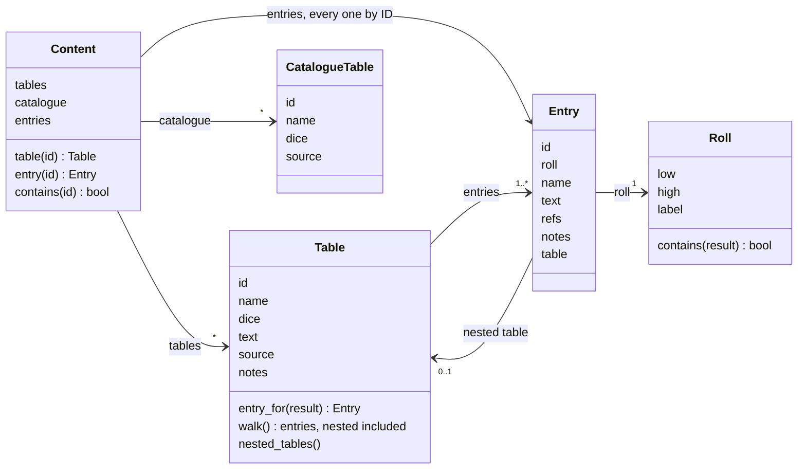

# Architecture

How the Python code is built: packages, modules, the main classes and who calls whom. What the game is lives in [`design/`](../design/), in domain terms; this page is about the code that implements it.

It describes only what exists. Each session updates it at wrap-up when the code structure changes ([Working with Claude](../WorkingWithClaude.md#how-a-session-works)).

## Packages

```
src/alone_against_fear/
  content/          the rules text: YAML files, their loader and model
    loader.py       YAML files → Content
    model.py        Content, Table, Entry, Roll, CatalogueTable, the checks
    catalogue.yaml  tables known but not copied yet
    tables/         one YAML file per copied table
```

Rules that hold for every package ([`CLAUDE.md`](../CLAUDE.md)): the engine never reads input or prints, and the game state refers to content by ID only and never holds code.

## `content`: the rules text

The book's text, copied into YAML, loaded once and read by ID. The format (files, IDs, fields) and the reasons behind it are in [rules text in YAML](content.md).





- **Read-only.** Every class is a frozen dataclass: content never changes once loaded. The game state will hold IDs pointing into it, never copies.
- **`Content` indexes every entry by ID**, nested and named ones included, so `content.entry("mission.bring_home_the_bacon")` and `content.entry("table.random_encounter.3.3-5")` both work. `id in content` is true for a table, an entry or a catalogued table: that is what references are checked against.
- **A nested table has the ID of the entry that holds it** (`table.random_encounter.3`), and its entries' notes point to the top table's `notes`.
- **Two kinds of error.** The loader raises `ContentError` when a file is malformed: unknown key, bad roll, unknown dice, an ID defined twice. The checks return lists of problems (gaps and overlaps in the dice, references or notes pointing to nothing), so a test can show every problem at once.
- **`TABLE_DICE`** gives the results of each table dice code (`d6`, `2d6`, `d66`), for the coverage check. It will move to the dice module in E1.
- **`KINDS`** lists the first segments an ID may have (`table`, `mission`); a YAML batch adds the kinds it needs.

Used by: the tests only, for now. Book mode (E5) will be the first engine user.

## Tests

| File | What it covers |
| --- | --- |
| `tests/test_content.py` | the real content: the checks over every table, then what each table says, written from the book |
| `tests/test_content_validation.py` | each check on a small made-up content, so a check that never fires cannot pass unnoticed |
| `tests/test_smoke.py` | the package imports |
