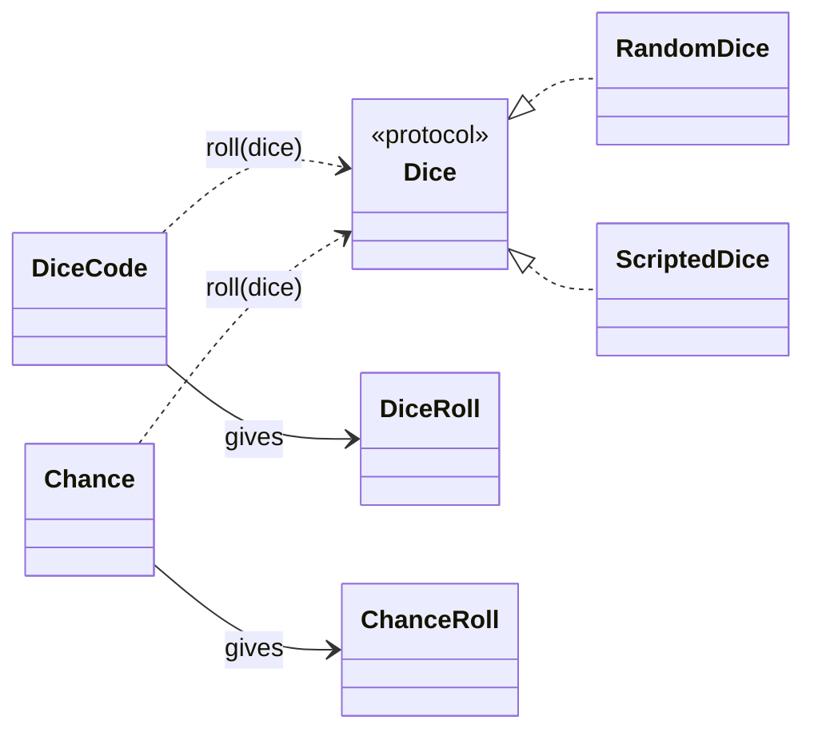
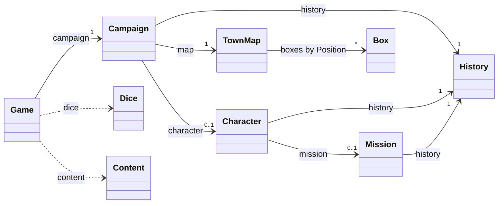
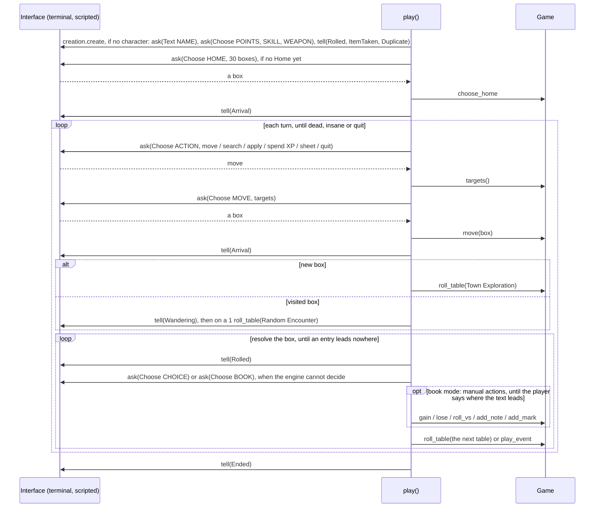
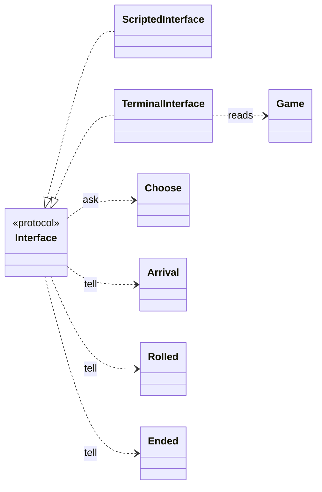
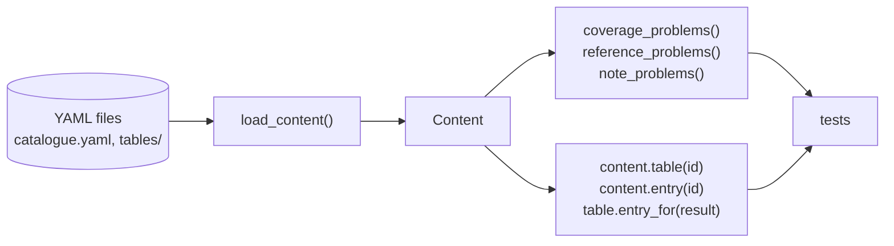
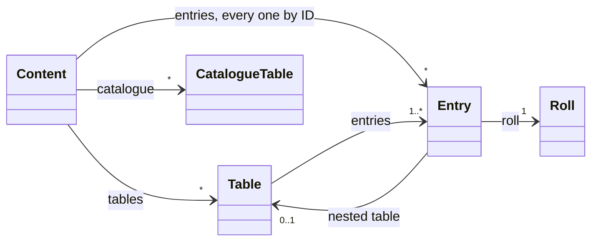

# Architecture

How the Python code is built: packages, modules, the main classes and who calls whom. What the game is lives in [`design/`](../design/), in domain terms; this page is about the code that implements it.

It describes only what exists. Each session updates it at wrap-up when the code structure changes ([Working with Claude](../WorkingWithClaude.md#how-a-session-works)). Diagrams show the classes and how they connect; their fields and methods are read in the code, so the diagrams do not drift from it.

## Packages

```
src/alone_against_fear/
  __main__.py       python -m alone_against_fear: the terminal
  dice.py           dice codes, chances, dice sources (shared by content and engine)
  effect_targets.py what an effect can change: roll types, tags, parameters (shared too)
  engine/           the game: state and the engine API
    state.py        Campaign, Character, Item, Lasting, Mission, History, TownMap, Box (plain data)
    town.py         sheets, neighbours, distance (pure geometry)
    game.py         Game: the only way the state changes
    effects.py      effects in play, read from what the character holds; roll modifiers
    protocol.py     requests, events, Interface: how the engine talks to an interface
    loop.py         play(): the game loop, arriving in a box
    moments.py      announce(): a moment's reactions (the Food upkeep), then lifetimes counted down
    creation.py     create(): walking the player through character creation; pregenerated()
    book_mode.py    resolving a box: follow each entry; book mode for what the engine cannot read
    manual.py       manual actions: how the player applies a text the engine cannot read
    leads.py        how the arrival and Search tables' entries lead on (until E10)
  interface/        what answers the engine: reads input, shows the game
    scripted.py     ScriptedInterface: prepared answers, for tests
    terminal.py     TerminalInterface and main(): play in the terminal
  content/          the rules text: YAML files, their loader and model
    loader.py       YAML files → Content
    model.py        Content, Table, Entry, Roll, CatalogueTable, CatalogueEvent, Weapon, Skill, Gear, the checks
    catalogue.yaml  tables and numbered events known but not copied yet
    tables/         one YAML file per copied table
    weapons/        the weapon summary: a list of weapons
    skills/         the Skills and the Arcane Skills: two lists
```

Rules that hold for every package ([`CLAUDE.md`](../CLAUDE.md)): the engine never reads input or prints, and the game state refers to content by ID only and never holds code.

**Logging.** Every module logs to a child of the `alone_against_fear` logger (standard `logging`): rolls at DEBUG, state changes at INFO. Every answer to a request is logged at INFO (`answer move: (2, 3)`). The engine only emits; the interface decides where the log goes: the terminal writes it to `logs/<date-time>.log` (git-ignored) at DEBUG. Tests read it with `caplog`.

## `dice`: dice codes and dice sources



- **Dice codes are parsed from the book's notation** (`"2d6+1"`, `"d6 x d6"`, `"12+d6"`, `"d66"`) and shown back in a standard form (`str(code)`). `Combine` says how the dice make the total: sum, product (`d6xd6`) or digits (`d66`). A d3 is a d6 halved. `"x in 6"` is a `Chance`, true on a die showing x or less.
- **Every roll goes through a `Dice` source** that only rolls d6: `RandomDice(seed)` for play and reproducible tests (with no seed it picks one and logs it, so a game's dice can be rolled again), `ScriptedDice([...])` for rule tests that state the faces shown. A result keeps every face, so rules can read the natural die.
- **Plain data.** Codes and results are frozen dataclasses; the content loader stores a table's dice in standard form and its coverage check asks `DiceCode.results()`.

## `effect_targets`: what an effect can change

The names the YAML and the engine share (E7, [rolls](../design/rolls.md)): `RollType` (Attack, Defense, Save, … Search), `Tag` (what a roll is about: its weapon, its opponent, the danger) and `Parameter` (a number the rules read: max Life and Sanity, carry limit, Food interval, surprise chance, Clue cost). Names only: the loader checks every effect against them, the engine rolls and calculates with them. `IMPLIED` says a tag carries another (a bow is ranged), `with_implied` adds them. At the package's top level like `dice`, because the content must not depend on the engine.

## `engine`: the game state and the engine API



- **The state is mutable plain data**: dataclasses of numbers, strings, enums, lists, dicts and counters, content referred to by ID. A test walks the whole campaign to check it holds no code, so saving it later is turning it into a dict.
- **Levels nest as in the design**: the campaign never forgets, a new character replaces the last one (and its history), a new mission replaces the last one. `Level` names them; `Game.history(level)` finds the right one.
- **The history counts, it does not log**: `Happened.PLAYED`, `FOUND`, `KILLED` per ID, plus keywords. The rules only ask "has it happened?" and "how many times?". The story of the game goes to the log file instead.
- **`Game` is the only writer.** It checks only what the state cannot hold (no character, unknown mission, negative amount, missing item) and raises `GameError`; the rules about limits come with their tasks. 
- **The town is one grid** (`town.py`). `Position` is a `(column, row)` named tuple, for a box in the town and for a sheet in the grid of sheets. A sheet is a 5×6 block (`sheet_of`); `neighbours(position, sheets)` are the 8 boxes around that lie on an attached sheet (open edges are walls), `distance` is the larger of the column and row gaps. Nothing geometric is stored.
- **Moves.** The engine offers `targets(kind)` and the interface picks; `move(to, kind)` refuses anything else, numbers the box and returns an `Arrival`; the box of time it takes is announced by the loop (`moments`, E8). `MoveKind` has `NORMAL` and `ESCAPE` for now. `choose_home` is box 1 (first sheet, once); `add_sheet` attaches a sheet against a full one.
- **A box remembers** its places (IDs), `searched` and `marks` (`Mark.SAFE_HOUSE`; other marks are strings until their task).
- **Effects** (E7, `effects.py`) are not stored: `Game.effects()` reads them from what the character holds (`held`: each Skill's `effects` at the level held, as `Held(source, effect, amount)`), so removing a source removes its effects. Since E8 they also come from the Injuries and Mental Scars held (`character.injuries`, `mental_scars`: entry IDs, their entries' `effects` with a single amount; `gain_injury` and `gain_mental_scar` refuse a duplicate) and from the **lasting effects**, the only ones stored: `Lasting(effect, source, moment, remaining)` on the character, ending when `remaining` counts of its moment have happened, or never (until removed). `add_lasting(effect, boxes)` counts boxes + 1 boxes of time, so it ends as the box after the last starts ([ruling](../design/rulings.md#effects)); `ends_at(lasting)` is that box number; `count_down(moment)` lowers the counts and returns what ended; `remove_lasting`. An effect with neither a roll type nor a parameter changes every roll, the Search included; its source is `effects.PLAYER` when the player added it. `Game.parameter(parameter, base)` is the base (the character's for max Life and Sanity, `PARAMETER_BASES` for the carry limit and the Food interval, the caller's for the surprise chance and the Clue cost) plus the effects, never below `PARAMETER_FLOORS`. `Game.roll_modifiers(roll, tags)` collects the matching modifiers (`Modifier(source, amount)`, source None for the one typed from a text) as `RollModifiers(applied, set_aside)`: they stack, except within an effect's `group`, where the highest applies and the others are set aside. `depending_on_tags(roll)` lists the effects on a roll type that apply only to some tags: what a roll made by hand asks about.
- **The character** (E6) has a name, current Life and Sanity and their base values, Skills (ID → `SkillLevel.BASIC` or `EXPERT`) and the items held (`Item`: an item or weapon ID, the entry or Skill it came from, a count and uses, frozen). `create_character(life, sanity, food, items, name, skills)` refuses an ID that is not a Skill (Arcane Skills included). `max(stat)` is the parameter (base plus effects) for Life and Sanity, None for the others; `gain` stops at the max. The Life and Sanity given at creation are the base: the character starts at the max (Tough raises it). Buying a Skill that raises a max raises the current value by as much. `purchases()` lists the Skills the XP can buy now (`Purchase(skill_id, level, cost)`: a new Skill at Basic, or one held at Basic to Expert for its cost again; no Arcane Skill until E18), `buy(purchase)` refuses anything else. `add_item` and `remove_item` keep the items.
- **The character's notes** (`Note`: a text and the box number it was written at) are the player's reminders of what the engine cannot track; `add_note` and `remove_note` keep them, nothing reads them.
- **Rolls.** `roll_vs(level, roll, tags, modifier)` rolls d6 vs L with the modifiers collected for its type and tags (implied tags added) plus the text's, a natural 1 failing and a natural 6 succeeding, and returns `RolledVsL` (type, tags, face, modifiers applied and set aside, total). `search(modifier)` adds the Search modifiers held (Investigator) and rolls the Search table (a natural 1 stays 1, the result kept on the table), marks the box Searched, records the entry and returns `Searched`; `may_search()` says whether the box may be Searched (once, never a Safe House).
- **The Food clock** (E8): `campaign.last_meal` is the box number of the last upkeep; `next_meal()` is it plus the Food interval read now (`Parameter.FOOD_INTERVAL`: 5, Resistant to Hunger +1 / +2, Eating Disorder -2, never below 1), so a change applies to the interval already running. `food_upkeep()` eats 1 Food, or loses 1 Life without, once the box number reaches the next meal (an overdue meal is one meal), and returns `Upkeep` or None ([rulings](../design/rulings.md#map)).
- **`ended()`** says why the game is over (`End.DEAD` at 0 Life, checked first, `End.INSANE` at 0 Sanity) or None; the loop and book mode both ask it. `End` lives in `state.py`.
- **Tables and events.** `roll_table(id)` rolls a table's dice, then the dice of the table nested in the entry reached, and returns `Rolled(table_id, results, entry_id)`; a catalogued table is rolled too, with no entry (its source holds it). `play_event(id)` plays a catalogued event. Both record what was reached as `PLAYED` at every level there is (campaign, character, mission), and a place table (`PLACE_TABLES`) rolled where the character stands becomes one of the box's places. `new_sheets()` lists where a sheet may be attached.
- **The dice are not part of the state**: play is random, so a resumed campaign rolls fresh dice.

## `engine.protocol` and `engine.loop`: the engine asks, the interface answers





- **Callback protocol.** The engine holds the interface and calls it while the rules run: `ask(request)` returns the player's answer at once, `tell(event)` reports what happened, in order. A rule deep inside another (a fight inside an event inside an arrival) asks the same way. Chosen over generators (every function on the path would need `yield from`) and a state machine (every multi-step rule cut into states). The price: the game can only be saved between turns, which fits "saving = saving the campaign"; a GUI would run the engine in a thread.
- **Requests and events are plain data.** Three requests: `Choose(topic, options, about)` picks one option (`about` says what the question is about when the topic does not: the effect a `TAG` question asks about), `Number(topic, minimum, maximum)` a whole number within its bounds (an amount, an L, a modifier), `Text(topic)` a text that is not empty (a note). The topic tells the interface how to show it (a map for `HOME` and `MOVE`, a menu for `ACTION`, `CHOICE`, `BOOK`, `APPLY` and `POINTS`, a list for `TABLE`, `EVENT`, `SHEET`, `STAT`, `NOTES`, `TARGET`, `LASTING`, `SKILL`, `WEAPON`, `PURCHASE` and `ROLL`, a yes or no for `TAG`, a prompt for `AMOUNT`, `LEVEL`, `MODIFIER`, `BOXES`, `NOTE`, `NAME` and `LIFE_POINTS`). Events are `Arrival` (from `Game.move`, and for Home), `FoodUpkeep` (a meal or 1 Life lost, E8), `EffectEnded` (a lasting effect ran its course), `Rolled` (from `Game.roll_table`), `Wandering` (the 1 in 6 of a visited box), `LeadRolled` (a die an entry rolls to pick its table or what it gives), `EventPlayed`, `SheetAttached`, `Changed` (a number gained or lost), `RolledVsL`, `Searched`, `Marked`, `NoteWritten`, `NoteRemoved`, `LastingAdded`, `LastingRemoved`, `ItemTaken`, `Duplicate` (a creation roll that gave something held already), `Bought` and `Ended`. Events carry IDs; the interface reads the text in `game.content`.
- **The answer must fit the request**: one of the options, a number within the bounds, a text that is not empty. `protocol.ask` refuses anything else with `GameError`, logs the answer and returns it (the option itself, the text without the spaces around it). A scripted answer that does not fit fails the test; the terminal checks the input before answering.
- **`Quit`** may be raised by an interface at any request: the game ends with `End.QUIT` (the terminal raises it on Ctrl-D or Ctrl-C).
- **The loop** (`play(game, interface) -> End`): creates a character if there is none (`creation.create`), asks for Home if it is not chosen, then turns, as in the [game flow](../design/game-flow.md#2-mission): move, arrive, free actions. The free actions keep their place: `MOVE` first, `SEARCH` while the box may be Searched, `APPLY` ("apply an effect": `manual.apply_effects`), `SPEND_XP` while `Game.purchases()` is not empty (a `PURCHASE` among them, or `Manual.BACK`), `SHEET` once a sheet is full, `QUIT` last. The Search asks a `MODIFIER` only when the character has notes, then follows its entry (`book_mode.follow`). Moving asks a box among `Game.targets()`, in reading order, and arrives: a new box rolls Town Exploration, a visited one (Home included, until Safe Houses) has a 1 in 6 Random Encounter, and the box is resolved before any free action. Arriving announces a box of time first (`moments.announce(game, interface, Moment.TIME_PASSES)`): its reactions run (`moments.RULES`: the Food upkeep, told as `FoodUpkeep`), then the lasting effects counting it go down and the ones that end are told (`EffectEnded`). A Food upkeep that kills stops the arrival. Reactions take the interface, so a later one can ask the player. The game ends at 0 Life (dead, checked first, [ruling](../design/rulings.md#character)), 0 Sanity (insane) or quit.
- **Character creation** (`creation.create(game, interface)`, E6): a name; the 3 points (`Points`: Life and Sanity split by a `LIFE_POINTS` number, or 1 more Skill or table roll); 2 or 3 Skills; `Game.create_character`; then a private `_Giving` gives the Skills' `starting_gear`, rolls Random Weapon (and asks the knife or stick), Random Objects and Useful Stuff, and d6 Food through a gain. An entry gives its `item`, or the weapon among its `refs` (asked when two are offered, the variants not held), with its `count` and `uses` rolled. A duplicate is anything held already, or an entry reached already for what is neither: `Duplicate` is told and the table rolled again. Entries that give something else are keyed by ID in `creation.py`: the samurai sword picked by a die (`PICKED_BY_DIE`, to move into the YAML in E10), Food points (`FOOD_POINTS`), and the books, followed with `book_mode.lead_on`. `creation.pregenerated(game, id)` (T1) makes a sample pregenerated character from its sheet instead, with no question: its Life, Sanity and Food as printed, Skills at Basic, its gear as `Item`s with no source.
- **Resolving a box** (`book_mode.resolve(game, interface, id)`, or `follow(game, interface, rolled)` for a table already rolled; `lead_on` follows an entry already rolled and told): reaches a table or event through `Game`, tells the interface, then follows where the entry leads until it leads nowhere. A copied entry with a written lead (`leads.LEADS`, keyed by entry ID) plays itself: `Auto` rolls the one table named, `Choice` asks among the tables named ("your choice", nothing else offered), `DieRoll` rolls the die and tells `LeadRolled`, `Nowhere` ends the chain. **Book mode** is what the engine cannot read: a table not copied yet, a numbered event, or a copied entry with no written lead. The `BOOK` menu offers where the text leads (`Book.TABLE` then any table, `Book.EVENT` then any event, or the entry's own references), the manual actions, and `Book.DONE`; it comes back after each manual action. At 0 Life or Sanity it offers only the manual actions and `DONE`, so the chain stops at the entry that kills, once its effects are applied. `leads.py` covers Town Exploration, Random Encounter and Search, a transitional step until E10's result scripts.
- **Manual actions** (`manual.py`): `Manual` lists them; `offered(game)` gives the ones an entry allows now (gain; lose, only the numbers above 0; roll vs L, which asks its type, its L, a yes or no for each effect held that depends on its tags, skipped when the tags given already match it, then the text's modifier; add a lasting effect, which asks its `TARGET` (`manual.ALL_ROLLS` or a roll type), its `MODIFIER` (0 adds nothing) and its `BOXES` (0 for until removed), and tells `LastingAdded`; remove one, if any, telling `LastingRemoved`; write a note; remove one, if any; mark a Safe House, unless the box is one), `apply(game, interface, action)` asks what it needs, changes the state through `Game` and tells the event. A loss stops at 0. `apply_effects` is the free action: the ones about the character, until `Manual.BACK`.
- **Interfaces read the game, never change it**: the terminal reads `Game` to draw the status line and the map; only its answers move the game on.

## `interface`: scripted and terminal

- **`ScriptedInterface(answers)`** gives the answers in order, remembers what was `asked` and `told`, and raises `ScriptError` when it runs out. Used by the scenario tests.
- **`TerminalInterface(game, input_fn, output_fn)`**: a status line before each action (name, box, Life and Sanity over their max, Food with the next meal, XP, Clues), then the Skills, Injuries, Mental Scars, items held and lasting effects ("-1 on all rolls (ends at box 14)"), a map of the attached sheets with numbered options (`[1]`), `@` where the character stands, `H` for Home and the last number of visited boxes; a wrong choice is asked again. Input and output are passed in so tests type lines.
- **Resolving a box in the terminal**: the entry reached with the notes it points to, or, for a table not copied yet, its source and the number rolled, then "Apply the text, then where does it lead?" (`t`, `e`, the manual actions, `d`). A table's own rules are shown the first time it is rolled in a game, and again on `r`; this is the terminal's choice, not the engine's. Actions have letters so they keep their key (`m` move, `s` search, `a` apply an effect, `n` new sheet, `q` quit; `g` gain, `l` lose, `v` roll vs L, `f` add a lasting effect, `u` remove one, `w` write a note, `x` remove one, `h` Safe House, `b` back); tables, numbers to lose or gain and notes to remove are numbered.
- **Creation in the terminal**: a name, the points by letter (`l`, `k`, `w`, `o`, `u`), the Skills with their text the first time, weapons with their text; what is taken ("You take: …"), duplicates ("You have it already: roll again."). `p` spends XP: "Agile: 8 XP", "(Expert)" for the second level.
- **Rolls in the terminal** (E7): the roll types numbered; "Does this Save involve poison, infection or disease? (Resilient +1) [y/n]"; the result names each modifier and what was set aside: "Defense vs L5: rolled 3, Dodge +2 (Agile +1 does not stack), total 5. Success."
- **Typed answers**: a number is asked again until it fits its bounds (Enter alone is no modifier), a note until it is not empty. The character's notes are shown under the status line, and above a modifier to type.
- **`main(argv)`** (console script `alone-against-fear`, or `python -m alone_against_fear`): `--seed`, `--log-dir` (default `logs`); sets up the log file, loads the content, plays.

## `content`: the rules text

The book's text, copied into YAML, loaded once and read by ID. The format (files, IDs, fields) and the reasons behind it are in [rules text in YAML](content.md).





- **Read-only.** Every class is a frozen dataclass: content never changes once loaded. The game state will hold IDs pointing into it, never copies.
- **`Content` indexes every entry by ID**, nested and named ones included, so `content.entry("mission.bring_home_the_bacon")` and `content.entry("table.random_encounter.3.3-5")` both work. `id in content` is true for a table, an entry or a catalogued table: that is what references are checked against.
- **A nested table has the ID of the entry that holds it** (`table.random_encounter.3`), and its entries' notes point to the top table's `notes`.
- **Two kinds of error.** The loader raises `ContentError` when a file is malformed: unknown key, bad roll, unknown dice, an ID defined twice. The checks return lists of problems (gaps and overlaps in the dice, references or notes pointing to nothing), so a test can show every problem at once.
- **A table's `dice`** is any dice code, kept in standard form; the coverage check asks `DiceCode` for its results.
- **`KINDS`** lists the first segments an ID may have (`table`, `mission`, `event`, `weapon`, `item`, `skill`, `arcane_skill`, `injury`, `mental_scar`); a YAML batch adds the kinds it needs.
- **The catalogue holds tables and numbered events** (`CatalogueTable`, `CatalogueEvent`, told apart by the ID's kind); `content.events()` lists the events in order.
- **A weapon list** (a file with a `weapons` key, no dice) loads as `Weapon`s (ID, name, text, source), in `content.weapons`; `id in content` is true for a weapon, so table entries can point to one. A heading that names two weapons lists them as `variants` (E6): each is a `Weapon` of its own in `content.variants`, with the heading's text plus its `extra` sentence and the heading's ID in `heading`; `content.weapon(id)` finds both.
- **Items** (E6): an entry may name the `item` it gives (an `item.` ID, defined only there and shared across tables), with its `count` (a dice code, a number, or a mapping per item or weapon, read with `entry.count_of(id)`) and `uses`. `content.items` maps an item ID to the entries that give it; `id in content` is true for an item.
- **A Skill list** (a file with a `skills` or an `arcane_skills` key) loads as `Skill`s (ID, name, XP cost, text, the Expert line; components and sacrifice for an Arcane Skill), in `content.skills` and `content.arcane_skills`; `content.skill(id)` finds either kind. A Skill's `effects` are `Effect`s (a roll type with tags and a group, or a parameter, and the Basic and Expert amounts; E7), their names checked against `effect_targets` at load time. A Skill's `starting_gear` is a tuple of `Gear` (an item or weapon ID, count, uses), checked by `reference_problems`.
- **The pregenerated characters** (T1; a file with a `characters` key) load as `Pregenerated` (ID, name, Life, Sanity, Food, Skill IDs, gear as `Gear` with written numbers), in `content.pregenerated`; `reference_problems` checks their Skills and gear.

Used by: `Game.roll_table` and `Game.play_event` (book mode), `Game.start_mission`, which checks mission IDs, the terminal, which shows the text, and the tests.

## Tests

| File | What it covers |
| --- | --- |
| `tests/test_content.py` | the real content: the checks over every table, then what each table says, written from the book |
| `tests/test_content_validation.py` | each check on a small made-up content, so a check that never fires cannot pass unnoticed; the weapon, Skill list and pregenerated character loaders |
| `tests/test_dice.py` | every dice code of the Dice Codes section, chances, seeded and scripted dice |
| `tests/test_game_state.py` | the game state through `Game`: levels, character, missions, boxes, history, plain data, logging |
| `tests/test_character.py` | the character: max Life and Sanity, Skills, buying them with XP, items held |
| `tests/test_effects.py` | every Skill's effects: roll modifiers at Basic and Expert, what they leave alone, stacking, parameters, max values, rolls and the Search collecting them; pending tests for Dodge's balance, Faith and Medic |
| `tests/test_pregenerated.py` | the two pregenerated characters as printed, and a character made from one |
| `tests/test_creation.py` | scenarios of character creation: the points, Skills and their gear, the tables rolled, duplicates, counts, the special entries |
| `tests/test_town_map.py` | sheets, neighbours, distance, moves, numbering, new sheets |
| `tests/test_moments.py` | the box of time as a moment: the Food upkeep and its clock (Resistant to Hunger, Eating Disorder, an interval changed between meals, an overdue meal), lasting effects held through their boxes and ending on time, on all rolls or one type |
| `tests/test_game_loop.py` | scenarios through a scripted interface: walking 10 boxes, what the engine asks, answers refused and logged, how a game ends, creation and spending XP in the loop |
| `tests/test_manual_actions.py` | scenarios of the manual actions: in book mode, "apply an effect", notes, lasting effects added and removed by hand, death once an entry is applied, the Search roll, rolls vs L and the questions about their tags, typed answers; pending tests (skipped) for the edge cases of later tasks |
| `tests/test_book_mode.py` | scenarios of resolving a box: new and visited boxes, automatic and chosen leads, the die an entry rolls, book mode after a table not copied yet, recording, places, attaching a sheet; long random games |
| `tests/test_terminal.py` | the terminal played with typed lines: walking 10 boxes, the map, wrong choices, end of input, the log file, the entries and rules shown, attaching a sheet, creation, spending XP, the character sheet, rolls naming their modifiers, meals and lasting effects told and shown |
| `tests/test_smoke.py` | the package imports |
