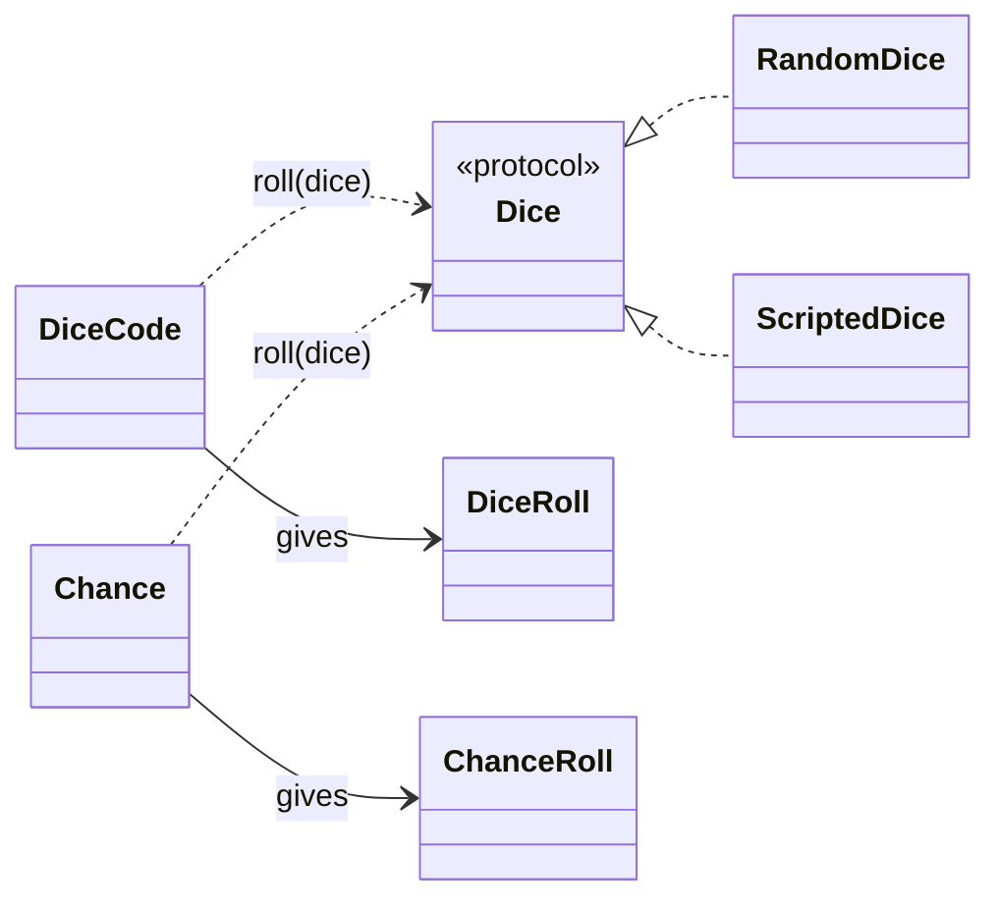
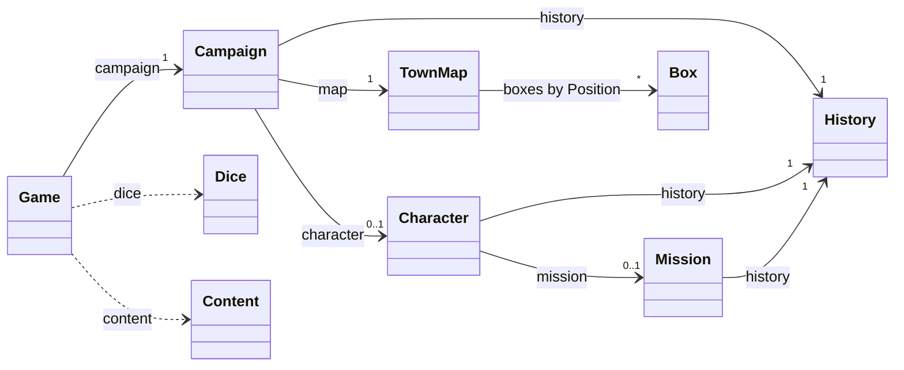
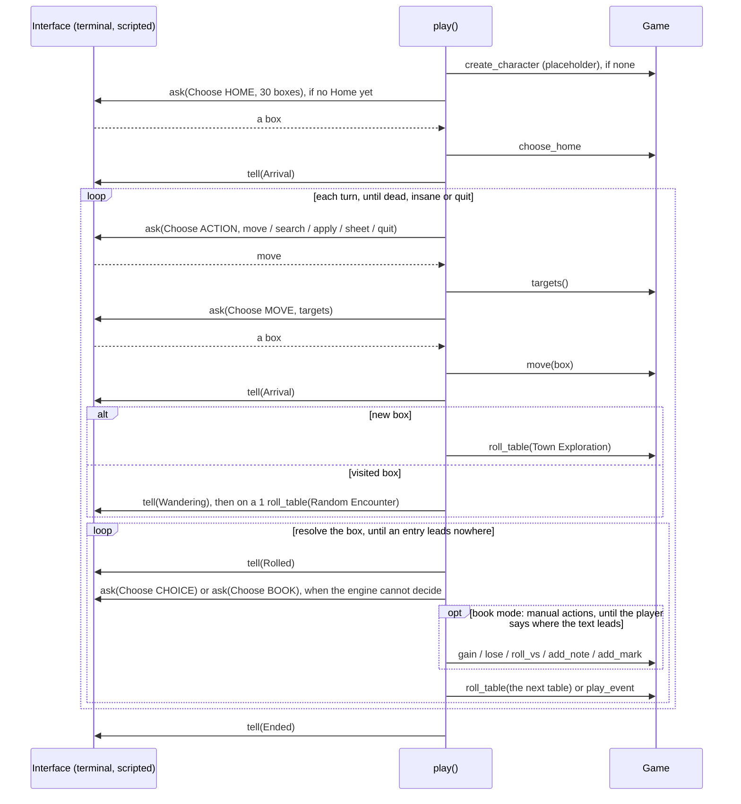
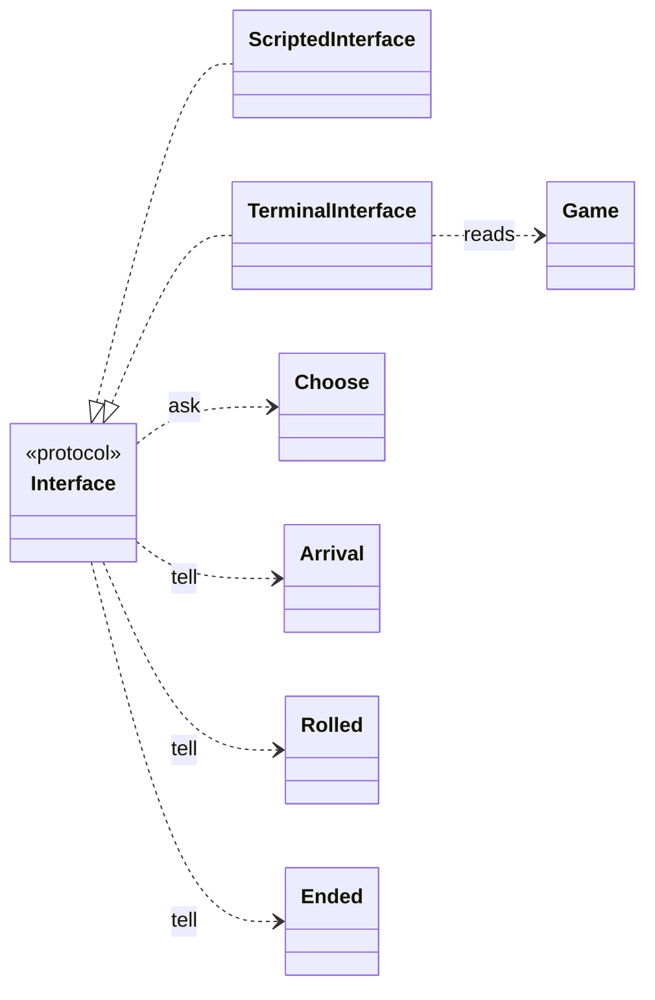
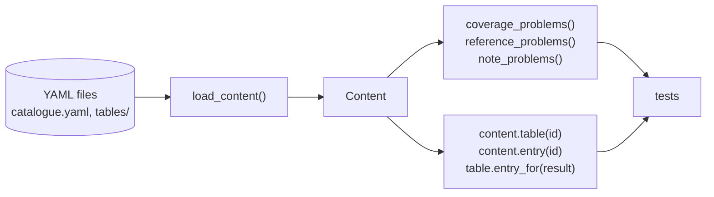
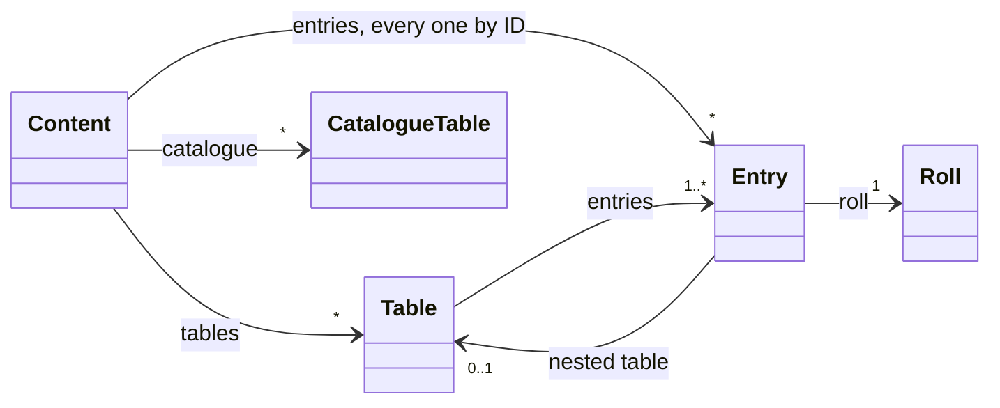

# Architecture

How the Python code is built: packages, modules, the main classes and who calls whom. What the game is lives in [`design/`](../design/), in domain terms; this page is about the code that implements it.

It describes only what exists. Each session updates it at wrap-up when the code structure changes ([Working with Claude](../WorkingWithClaude.md#how-a-session-works)). Diagrams show the classes and how they connect; their fields and methods are read in the code, so the diagrams do not drift from it.

## Packages

```
src/alone_against_fear/
  __main__.py       python -m alone_against_fear: the terminal
  dice.py           dice codes, chances, dice sources (shared by content and engine)
  engine/           the game: state and the engine API
    state.py        Campaign, Character, Mission, History, TownMap, Box (plain data)
    town.py         sheets, neighbours, distance (pure geometry)
    game.py         Game: the only way the state changes
    protocol.py     requests, events, Interface: how the engine talks to an interface
    loop.py         play(): the game loop, arriving in a box
    book_mode.py    resolving a box: follow each entry; book mode for what the engine cannot read
    manual.py       manual actions: how the player applies a text the engine cannot read
    leads.py        how the arrival and Search tables' entries lead on (until E10)
  interface/        what answers the engine: reads input, shows the game
    scripted.py     ScriptedInterface: prepared answers, for tests
    terminal.py     TerminalInterface and main(): play in the terminal
  content/          the rules text: YAML files, their loader and model
    loader.py       YAML files → Content
    model.py        Content, Table, Entry, Roll, CatalogueTable, CatalogueEvent, Weapon, Skill, the checks
    catalogue.yaml  tables and numbered events known but not copied yet
    tables/         one YAML file per copied table
    weapons/        the weapon summary: a list of weapons
    skills/         the Skills and the Arcane Skills: two lists
```

Rules that hold for every package ([`CLAUDE.md`](../CLAUDE.md)): the engine never reads input or prints, and the game state refers to content by ID only and never holds code.

**Logging.** Every module logs to a child of the `alone_against_fear` logger (standard `logging`): rolls at DEBUG, state changes at INFO. Every answer to a request is logged at INFO (`answer move: (2, 3)`). The engine only emits; the interface decides where the log goes: the terminal writes it to `logs/<date-time>.log` (git-ignored) at DEBUG. Tests read it with `caplog`.

## `dice`: dice codes and dice sources



- **Dice codes are parsed from the book's notation** (`"2d6+1"`, `"d6 x d6"`, `"12+d6"`, `"d66"`) and shown back in a standard form (`str(code)`). `Combine` says how the dice make the total: sum, product (`d6xd6`) or digits (`d66`). A d3 is a d6 halved. `"x in 6"` is a `Chance`, true on a die showing x or less.
- **Every roll goes through a `Dice` source** that only rolls d6: `RandomDice(seed)` for play and reproducible tests (with no seed it picks one and logs it, so a game's dice can be rolled again), `ScriptedDice([...])` for rule tests that state the faces shown. A result keeps every face, so rules can read the natural die.
- **Plain data.** Codes and results are frozen dataclasses; the content loader stores a table's dice in standard form and its coverage check asks `DiceCode.results()`.

## `engine`: the game state and the engine API



- **The state is mutable plain data**: dataclasses of numbers, strings, enums, lists, dicts and counters, content referred to by ID. A test walks the whole campaign to check it holds no code, so saving it later is turning it into a dict.
- **Levels nest as in the design**: the campaign never forgets, a new character replaces the last one (and its history), a new mission replaces the last one. `Level` names them; `Game.history(level)` finds the right one.
- **The history counts, it does not log**: `Happened.PLAYED`, `FOUND`, `KILLED` per ID, plus keywords. The rules only ask "has it happened?" and "how many times?". The story of the game goes to the log file instead.
- **`Game` is the only writer.** It checks only what the state cannot hold (no character, unknown mission, negative amount, missing item) and raises `GameError`; the rules about limits come with their tasks. 
- **The town is one grid** (`town.py`). `Position` is a `(column, row)` named tuple, for a box in the town and for a sheet in the grid of sheets. A sheet is a 5×6 block (`sheet_of`); `neighbours(position, sheets)` are the 8 boxes around that lie on an attached sheet (open edges are walls), `distance` is the larger of the column and row gaps. Nothing geometric is stored.
- **Moves.** The engine offers `targets(kind)` and the interface picks; `move(to, kind)` refuses anything else, numbers the box, runs the Food upkeep (every 5th box number on the campaign clock: 1 Food, else 1 Life) and returns an `Arrival`. `MoveKind` has `NORMAL` and `ESCAPE` for now. `choose_home` is box 1 (first sheet, once); `add_sheet` attaches a sheet against a full one.
- **A box remembers** its places (IDs), `searched` and `marks` (`Mark.SAFE_HOUSE`; other marks are strings until their task).
- **The character's notes** (`Note`: a text and the box number it was written at) are the player's reminders of what the engine cannot track; `add_note` and `remove_note` keep them, nothing reads them.
- **Rolls.** `roll_vs(level, modifier)` rolls d6 vs L, a natural 1 failing and a natural 6 succeeding, and returns `RolledVsL`. `search(modifier)` rolls the Search table (a natural 1 stays 1, the result kept on the table), marks the box Searched, records the entry and returns `Searched`; `may_search()` says whether the box may be Searched (once, never a Safe House).
- **`ended()`** says why the game is over (`End.DEAD` at 0 Life, checked first, `End.INSANE` at 0 Sanity) or None; the loop and book mode both ask it. `End` lives in `state.py`.
- **Tables and events.** `roll_table(id)` rolls a table's dice, then the dice of the table nested in the entry reached, and returns `Rolled(table_id, results, entry_id)`; a catalogued table is rolled too, with no entry (its source holds it). `play_event(id)` plays a catalogued event. Both record what was reached as `PLAYED` at every level there is (campaign, character, mission), and a place table (`PLACE_TABLES`) rolled where the character stands becomes one of the box's places. `new_sheets()` lists where a sheet may be attached.
- **The dice are not part of the state**: play is random, so a resumed campaign rolls fresh dice.

## `engine.protocol` and `engine.loop`: the engine asks, the interface answers





- **Callback protocol.** The engine holds the interface and calls it while the rules run: `ask(request)` returns the player's answer at once, `tell(event)` reports what happened, in order. A rule deep inside another (a fight inside an event inside an arrival) asks the same way. Chosen over generators (every function on the path would need `yield from`) and a state machine (every multi-step rule cut into states). The price: the game can only be saved between turns, which fits "saving = saving the campaign"; a GUI would run the engine in a thread.
- **Requests and events are plain data.** Three requests: `Choose(topic, options)` picks one option, `Number(topic, minimum, maximum)` a whole number within its bounds (an amount, an L, a modifier), `Text(topic)` a text that is not empty (a note). The topic tells the interface how to show it (a map for `HOME` and `MOVE`, a menu for `ACTION`, `CHOICE`, `BOOK` and `APPLY`, a list for `TABLE`, `EVENT`, `SHEET`, `STAT` and `NOTES`, a prompt for `AMOUNT`, `LEVEL`, `MODIFIER` and `NOTE`). Events are `Arrival` (from `Game.move`, and for Home), `Rolled` (from `Game.roll_table`), `Wandering` (the 1 in 6 of a visited box), `LeadRolled` (a die an entry rolls to pick its table), `EventPlayed`, `SheetAttached`, `Changed` (a number gained or lost), `RolledVsL`, `Searched`, `Marked`, `NoteWritten`, `NoteRemoved` and `Ended`. Events carry IDs; the interface reads the text in `game.content`.
- **The answer must fit the request**: one of the options, a number within the bounds, a text that is not empty. `protocol.ask` refuses anything else with `GameError`, logs the answer and returns it (the option itself, the text without the spaces around it). A scripted answer that does not fit fails the test; the terminal checks the input before answering.
- **`Quit`** may be raised by an interface at any request: the game ends with `End.QUIT` (the terminal raises it on Ctrl-D or Ctrl-C).
- **The loop** (`play(game, interface) -> End`): creates the placeholder character if there is none (Life 8, Sanity 8, Food d6, until E6), asks for Home if it is not chosen, then turns, as in the [game flow](../design/game-flow.md#2-mission): move, arrive, free actions. The free actions keep their place: `MOVE` first, `SEARCH` while the box may be Searched, `APPLY` ("apply an effect": `manual.apply_effects`), `SHEET` once a sheet is full, `QUIT` last. The Search asks a `MODIFIER` only when the character has notes, then follows its entry (`book_mode.follow`). Moving asks a box among `Game.targets()`, in reading order, and arrives: a new box rolls Town Exploration, a visited one (Home included, until Safe Houses) has a 1 in 6 Random Encounter, and the box is resolved before any free action. A Food upkeep that kills stops the arrival. The game ends at 0 Life (dead, checked first, [ruling](../design/rulings.md#character)), 0 Sanity (insane) or quit.
- **Resolving a box** (`book_mode.resolve(game, interface, id)`, or `follow(game, interface, rolled)` for a table already rolled): reaches a table or event through `Game`, tells the interface, then follows where the entry leads until it leads nowhere. A copied entry with a written lead (`leads.LEADS`, keyed by entry ID) plays itself: `Auto` rolls the one table named, `Choice` asks among the tables named ("your choice", nothing else offered), `DieRoll` rolls the die and tells `LeadRolled`, `Nowhere` ends the chain. **Book mode** is what the engine cannot read: a table not copied yet, a numbered event, or a copied entry with no written lead. The `BOOK` menu offers where the text leads (`Book.TABLE` then any table, `Book.EVENT` then any event, or the entry's own references), the manual actions, and `Book.DONE`; it comes back after each manual action. At 0 Life or Sanity it offers only the manual actions and `DONE`, so the chain stops at the entry that kills, once its effects are applied. `leads.py` covers Town Exploration, Random Encounter and Search, a transitional step until E10's result scripts.
- **Manual actions** (`manual.py`): `Manual` lists them; `offered(game)` gives the ones an entry allows now (gain; lose, only the numbers above 0; roll vs L; write a note; remove one, if any; mark a Safe House, unless the box is one), `apply(game, interface, action)` asks what it needs, changes the state through `Game` and tells the event. A loss stops at 0. `apply_effects` is the free action: the ones about the character, until `Manual.BACK`.
- **Interfaces read the game, never change it**: the terminal reads `Game` to draw the status line and the map; only its answers move the game on.

## `interface`: scripted and terminal

- **`ScriptedInterface(answers)`** gives the answers in order, remembers what was `asked` and `told`, and raises `ScriptError` when it runs out. Used by the scenario tests.
- **`TerminalInterface(game, input_fn, output_fn)`**: a status line before each action, a map of the attached sheets with numbered options (`[1]`), `@` where the character stands, `H` for Home and the last number of visited boxes; a wrong choice is asked again. Input and output are passed in so tests type lines.
- **Resolving a box in the terminal**: the entry reached with the notes it points to, or, for a table not copied yet, its source and the number rolled, then "Apply the text, then where does it lead?" (`t`, `e`, the manual actions, `d`). A table's own rules are shown the first time it is rolled in a game, and again on `r`; this is the terminal's choice, not the engine's. Actions have letters so they keep their key (`m` move, `s` search, `a` apply an effect, `n` new sheet, `q` quit; `g` gain, `l` lose, `v` roll vs L, `w` write a note, `x` remove one, `h` Safe House, `b` back); tables, numbers to lose or gain and notes to remove are numbered.
- **Typed answers**: a number is asked again until it fits its bounds (Enter alone is no modifier), a note until it is not empty. The character's notes are shown under the status line, and above a modifier to type.
- **`main(argv)`** (console script `alone-against-fear`, or `python -m alone_against_fear`): `--seed`, `--log-dir` (default `logs`); sets up the log file, loads the content, plays.

## `content`: the rules text

The book's text, copied into YAML, loaded once and read by ID. The format (files, IDs, fields) and the reasons behind it are in [rules text in YAML](content.md).





- **Read-only.** Every class is a frozen dataclass: content never changes once loaded. The game state will hold IDs pointing into it, never copies.
- **`Content` indexes every entry by ID**, nested and named ones included, so `content.entry("mission.bring_home_the_bacon")` and `content.entry("table.random_encounter.3.3-5")` both work. `id in content` is true for a table, an entry or a catalogued table: that is what references are checked against.
- **A nested table has the ID of the entry that holds it** (`table.random_encounter.3`), and its entries' notes point to the top table's `notes`.
- **Two kinds of error.** The loader raises `ContentError` when a file is malformed: unknown key, bad roll, unknown dice, an ID defined twice. The checks return lists of problems (gaps and overlaps in the dice, references or notes pointing to nothing), so a test can show every problem at once.
- **A table's `dice`** is any dice code, kept in standard form; the coverage check asks `DiceCode` for its results.
- **`KINDS`** lists the first segments an ID may have (`table`, `mission`, `event`, `weapon`, `skill`, `arcane_skill`, `injury`, `mental_scar`); a YAML batch adds the kinds it needs.
- **The catalogue holds tables and numbered events** (`CatalogueTable`, `CatalogueEvent`, told apart by the ID's kind); `content.events()` lists the events in order.
- **A weapon list** (a file with a `weapons` key, no dice) loads as `Weapon`s (ID, name, text, source), in `content.weapons`; `id in content` is true for a weapon, so table entries can point to one.
- **A Skill list** (a file with a `skills` or an `arcane_skills` key) loads as `Skill`s (ID, name, XP cost, text, the Expert line; components and sacrifice for an Arcane Skill), in `content.skills` and `content.arcane_skills`; `content.skill(id)` finds either kind.

Used by: `Game.roll_table` and `Game.play_event` (book mode), `Game.start_mission`, which checks mission IDs, the terminal, which shows the text, and the tests.

## Tests

| File | What it covers |
| --- | --- |
| `tests/test_content.py` | the real content: the checks over every table, then what each table says, written from the book |
| `tests/test_content_validation.py` | each check on a small made-up content, so a check that never fires cannot pass unnoticed; the weapon and Skill list loaders |
| `tests/test_dice.py` | every dice code of the Dice Codes section, chances, seeded and scripted dice |
| `tests/test_game_state.py` | the game state through `Game`: levels, character, missions, boxes, history, plain data, logging |
| `tests/test_town_map.py` | sheets, neighbours, distance, moves, numbering, Food upkeep, new sheets |
| `tests/test_game_loop.py` | scenarios through a scripted interface: walking 10 boxes, what the engine asks, answers refused and logged, how a game ends |
| `tests/test_manual_actions.py` | scenarios of the manual actions: in book mode, "apply an effect", notes, death once an entry is applied, the Search roll, rolls vs L, typed answers; pending tests (skipped) for the edge cases of later tasks |
| `tests/test_book_mode.py` | scenarios of resolving a box: new and visited boxes, automatic and chosen leads, the die an entry rolls, book mode after a table not copied yet, recording, places, attaching a sheet; long random games |
| `tests/test_terminal.py` | the terminal played with typed lines: walking 10 boxes, the map, wrong choices, end of input, the log file, the entries and rules shown, attaching a sheet |
| `tests/test_smoke.py` | the package imports |
