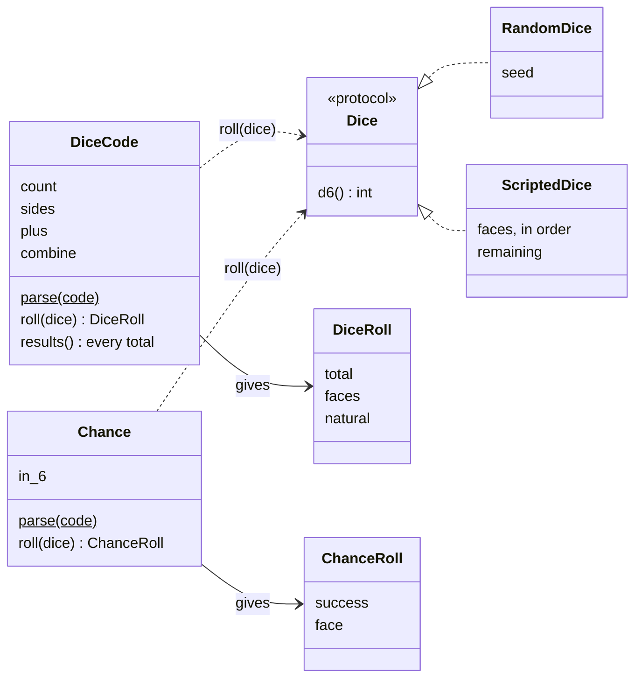
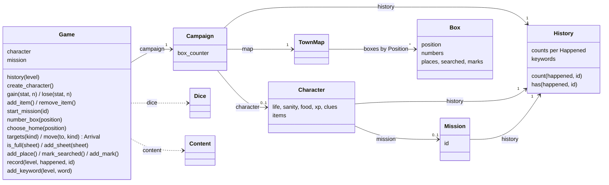
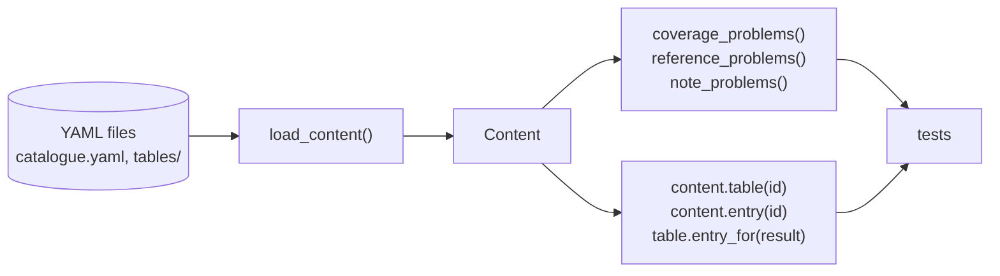
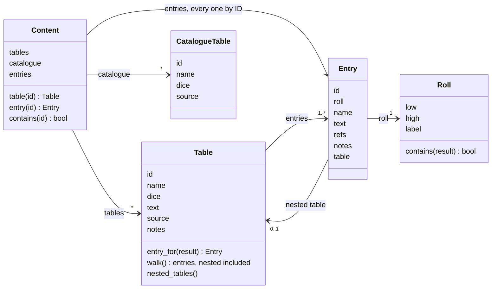

# Architecture

How the Python code is built: packages, modules, the main classes and who calls whom. What the game is lives in [`design/`](../design/), in domain terms; this page is about the code that implements it.

It describes only what exists. Each session updates it at wrap-up when the code structure changes ([Working with Claude](../WorkingWithClaude.md#how-a-session-works)).

## Packages

```
src/alone_against_fear/
  dice.py           dice codes, chances, dice sources (shared by content and engine)
  engine/           the game: state and the engine API
    state.py        Campaign, Character, Mission, History, TownMap, Box (plain data)
    town.py         sheets, neighbours, distance (pure geometry)
    game.py         Game: the only way the state changes
  content/          the rules text: YAML files, their loader and model
    loader.py       YAML files → Content
    model.py        Content, Table, Entry, Roll, CatalogueTable, the checks
    catalogue.yaml  tables known but not copied yet
    tables/         one YAML file per copied table
```

Rules that hold for every package ([`CLAUDE.md`](../CLAUDE.md)): the engine never reads input or prints, and the game state refers to content by ID only and never holds code.

**Logging.** Every module logs to a child of the `alone_against_fear` logger (standard `logging`): rolls at DEBUG, state changes at INFO. The engine only emits; the interface decides where the log goes (a file, from E4). Tests read it with `caplog`.

## `dice`: dice codes and dice sources



- **Dice codes are parsed from the book's notation** (`"2d6+1"`, `"d6 x d6"`, `"12+d6"`, `"d66"`) and shown back in a standard form (`str(code)`). `Combine` says how the dice make the total: sum, product (`d6xd6`) or digits (`d66`). A d3 is a d6 halved. `"x in 6"` is a `Chance`, true on a die showing x or less.
- **Every roll goes through a `Dice` source** that only rolls d6: `RandomDice(seed)` for play and reproducible tests, `ScriptedDice([...])` for rule tests that state the faces shown. A result keeps every face, so rules can read the natural die.
- **Plain data.** Codes and results are frozen dataclasses; the content loader stores a table's dice in standard form and its coverage check asks `DiceCode.results()`.

## `engine`: the game state and the engine API



- **The state is mutable plain data**: dataclasses of numbers, strings, enums, lists, dicts and counters, content referred to by ID. A test walks the whole campaign to check it holds no code, so saving it later is turning it into a dict.
- **Levels nest as in the design**: the campaign never forgets, a new character replaces the last one (and its history), a new mission replaces the last one. `Level` names them; `Game.history(level)` finds the right one.
- **The history counts, it does not log**: `Happened.PLAYED`, `FOUND`, `KILLED` per ID, plus keywords. The rules only ask "has it happened?" and "how many times?". The story of the game goes to the log file instead.
- **`Game` is the only writer.** It checks only what the state cannot hold (no character, unknown mission, negative amount, missing item) and raises `GameError`; the rules about limits come with their tasks. 
- **The town is one grid** (`town.py`). `Position` is a `(column, row)` named tuple, for a box in the town and for a sheet in the grid of sheets. A sheet is a 5×6 block (`sheet_of`); `neighbours(position, sheets)` are the 8 boxes around that lie on an attached sheet (open edges are walls), `distance` is the larger of the column and row gaps. Nothing geometric is stored.
- **Moves.** The engine offers `targets(kind)` and the interface picks; `move(to, kind)` refuses anything else, numbers the box, runs the Food upkeep (every 5th box number on the campaign clock: 1 Food, else 1 Life) and returns an `Arrival`. `MoveKind` has `NORMAL` and `ESCAPE` for now. `choose_home` is box 1 (first sheet, once); `add_sheet` attaches a sheet against a full one.
- **A box remembers** its places (IDs), `searched` and `marks`.
- **The dice are not part of the state**: play is random, so a resumed campaign rolls fresh dice.

## `content`: the rules text

The book's text, copied into YAML, loaded once and read by ID. The format (files, IDs, fields) and the reasons behind it are in [rules text in YAML](content.md).





- **Read-only.** Every class is a frozen dataclass: content never changes once loaded. The game state will hold IDs pointing into it, never copies.
- **`Content` indexes every entry by ID**, nested and named ones included, so `content.entry("mission.bring_home_the_bacon")` and `content.entry("table.random_encounter.3.3-5")` both work. `id in content` is true for a table, an entry or a catalogued table: that is what references are checked against.
- **A nested table has the ID of the entry that holds it** (`table.random_encounter.3`), and its entries' notes point to the top table's `notes`.
- **Two kinds of error.** The loader raises `ContentError` when a file is malformed: unknown key, bad roll, unknown dice, an ID defined twice. The checks return lists of problems (gaps and overlaps in the dice, references or notes pointing to nothing), so a test can show every problem at once.
- **A table's `dice`** is any dice code, kept in standard form; the coverage check asks `DiceCode` for its results.
- **`KINDS`** lists the first segments an ID may have (`table`, `mission`); a YAML batch adds the kinds it needs.

Used by: the tests, and `Game.start_mission`, which checks mission IDs. Book mode (E5) will be the first real engine user.

## Tests

| File | What it covers |
| --- | --- |
| `tests/test_content.py` | the real content: the checks over every table, then what each table says, written from the book |
| `tests/test_content_validation.py` | each check on a small made-up content, so a check that never fires cannot pass unnoticed |
| `tests/test_dice.py` | every dice code of the Dice Codes section, chances, seeded and scripted dice |
| `tests/test_game_state.py` | the game state through `Game`: levels, character, missions, boxes, history, plain data, logging |
| `tests/test_smoke.py` | the package imports |
