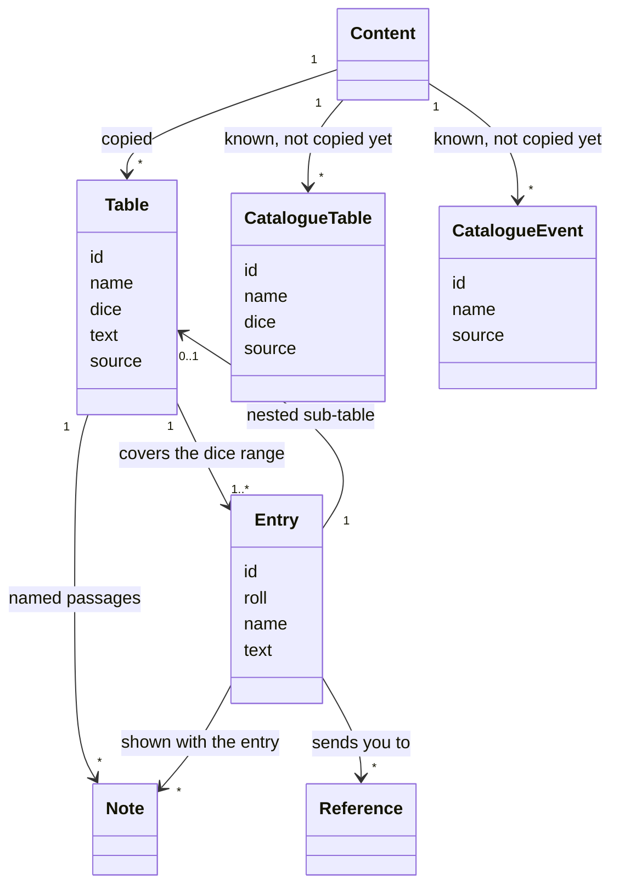

# Rules text in YAML

How the rules text is stored for the engine: files, IDs, the shape of a table, references between tables, and what is known but not copied yet. Why the text is copied at all is in [MVP scope](../design/mvp-scope.md#where-the-text-comes-from). Words are defined in the [glossary](../design/glossary.md). How the code loads and checks it: [architecture](architecture.md#content-the-rules-text). Decided in the R1 session.

## Structure



- **YAML holds the text, Python the behaviour**, both keyed by the same ID ([D1](../Readme.md#deferred)). The YAML holds no rules logic.
- **The text is copied as printed.** OCR damage is fixed against the original PDFs in `origin_rules/`, and page references become table names ("Roll on the Clinic table (p. 46)" becomes "Roll on the Clinic table"), and words that point at the page layout are dropped ("the Mission table below"). Nothing else changes. The Markdown in `gameRules/` is fixed in the same batch, so both copies say the same thing.
- **Obvious typos are fixed; other book errors stay as printed** (decided in R3). A misspelt word is fixed ("Scythe/showel" becomes "Scythe/shovel", "visit a stick" becomes "visit a park" as the weapon rules say). A missing word, odd grammar or anything whose meaning is unsure stays as printed ("1 dose be sacrificed") and goes to the list of [book errors kept as printed](../gameRules/book_errors.md), for a review session once the batches are done.
- **Every correction is shown to the user**: each batch reports every change to the printed text (OCR fixes, spacing and quotes included, page references, typos), with the printed words and the fix, so a misreading is caught before the batch is accepted.

## Files

```
src/alone_against_fear/content/
  catalogue.yaml          every table and numbered event not copied yet
  tables/
    town_exploration.yaml one file per table
    random_encounter.yaml
    search.yaml
    mission.yaml
  weapons/
    weapon_summary.yaml   the weapon summary: a list of weapons (R3)
    (later places/, creatures/ … as the batches need)
```

- The files live in the package, so the engine finds them wherever it is installed.
- **One file per table.** The YAML batches run in parallel sessions, and one file per table keeps them from touching the same files.
- **The ID is inside the file**, not taken from its name or folder. Files can be moved or regrouped later without changing any ID. The loader reads every `*.yaml` under `content/`.

## IDs

Lowercase words joined by `_`, segments joined by `.`. **The first segment is the kind**: `table`, `mission`, `event`, `weapon` so far; `creature`, `item`, `skill`… are added by the batch that first needs them.

| What | ID | Rule |
| --- | --- | --- |
| A table | `table.town_exploration` | a short name from the table's heading, without "table"; `/` becomes `_or_` (`table.woods_or_park`). The heading's number is kept ("Random book table" gives `table.random_book`); "Search rolls table" is `table.search`, the name the rules use |
| An entry | `table.town_exploration.7` | table ID, then the roll as printed: `7`, `2-5` |
| An entry of a nested table | `table.random_encounter.3.3-5` | parent entry ID, then the roll |
| A named entry | `mission.bring_home_the_bacon` | an entry that is a thing of its own takes that thing's ID instead |
| A numbered event | `event.12` | `event`, then the event's number in the book |
| A weapon | `weapon.axe` | `weapon`, then its heading in the weapon summary, the same way as a table: `/` becomes `_or_` (`weapon.hockey_stick_or_golf_club`), words in brackets are kept (`weapon.samurai_sword_authentic`) |

- **IDs are stable.** The game state refers to content by ID only, so an ID is never renamed once used.
- **Rolls in IDs keep the book's numbers.** The book's "1,2)" is written `1-2`.
- **Named entries**: a mission is something the game keeps track of ("the mission you played last time"), so it gets a readable ID instead of `table.mission.3`. Creatures and items decide their IDs in their own batch (R2 to R7), with the same idea.
- **Numbered events** keep the book's number (`event.12`): the rules call them by it ("play event #12"). Fixed in E5a, which catalogues them so book mode can record them as played.

## A table

```yaml
id: table.random_encounter
name: Random Encounter table
dice: d6
source: gameRules/tables/5_2_random_encounters_table.md
notes:
  unique_creatures: When rolling on tables of Unique creatures, reroll any monster that …
entries:
  - roll: 3
    table:                 # roll d6, then another d6
      dice: d6
      entries:
        - roll: 6
          text: Roll on the Unique Vampires table.
          refs: [table.unique_vampires]
          notes: [unique_creatures]
```

| Field | Of | Meaning |
| --- | --- | --- |
| `id`, `name`, `dice` | table | `dice` is `d6`, `2d6` or `d66` so far |
| `source` | table | the readable Markdown copy |
| `text` | table | the table's own rules: when to roll it, its modifiers ("Roll at +1 if you have the Investigator Skill") |
| `notes` | table | named passages that some entries point to |
| `roll` | entry | one number, or a range `2-5` |
| `text` | entry | the entry as printed |
| `name`, `id` | entry | for named entries only |
| `refs` | entry | the tables and events the entry tells you to roll on or play |
| `notes` | entry | the table's notes that apply to this entry |
| `table` | entry | a nested table, for "roll d6, then another d6" |

- **Entries cover the dice range exactly**: every result has one entry, no gaps, no overlaps. Nested tables too.
- **A nested table** is used only where the book prints one (Random Encounter). An entry that says "Roll d6. On a 1-5 … On a 6 …" stays one entry with its text, as printed (Town Exploration 7).
- **`text` and `notes` differ in who reads them.** The engine applies a table's own rules (it rolls Town Exploration in new boxes, it adds the Investigator bonus), so book mode does not need to show them on every roll. How they are shown is the interface's choice: the terminal shows them the first time the table is rolled in a game, and again on request (decided in E5a). A note is a rule about some results, which the player must apply by hand until the engine does: book mode shows it with every entry that points to it. The Random Encounter's sentence on Unique creatures is printed under 6 / 4-6 but applies to Unique Vampires on 3 / 6 and 6 / 1-3 too, so it is a note pointed to by all three.
- **`refs` name the tables and events an entry sends you to**, not how: roll the one named, choose one, roll to pick, only if a condition holds. That is behaviour, in Python by entry ID: `engine/leads.py` for the arrival tables (E5a), the result scripts of E10 later. Book mode offers the references of a copied entry whose behaviour is not written yet.

## A list of weapons

The weapon summary has no dice: it is a list of weapons, each with its rules. Its file holds the list's name and source, then the weapons in the book's order.

```yaml
name: Weapon summary table
source: gameRules/8_weapon_summary_table.md
weapons:
  - id: weapon.axe
    name: Axe
    text: >-
      Two-handed. Damage 2. If you are Strong (Expert), you may use it one-handed.
```

| Field | Of | Meaning |
| --- | --- | --- |
| `name`, `source` | list | the heading and the readable Markdown copy |
| `id`, `name`, `text` | weapon | the weapon's ID, its heading as printed, its rules as printed |

- **An item is its table entry, for now** (decided in the E5b session). The Random Objects and Useful Stuff entries are copied as printed, duplicates included (the Backpack is in both). Items get no ID of their own until a rule needs one (E6, E9).
- **A weapon has its own ID**, so the tables that give one point to it: Random Weapon 2, "Chainsaw or authentic samurai sword (choose)", has `refs: [weapon.chainsaw, weapon.samurai_sword_authentic]`, and the player picks one.
- **A heading that names two weapons keeps one ID, as printed** ("Baseball bat or hammer"). Likely to become two IDs sharing the same text when a rule needs to tell them apart; see E6 in the Readme.
- **Stats stay in the text** ("Damage 2") until D1 is decided (E6).

## Known but not copied yet

- **`catalogue.yaml` lists every table not copied yet**, with its ID, name, dice and Markdown source. A reference to a catalogued table is valid.
- **It lists the 42 numbered events too**, with their ID, name (as printed, the case fixed where the OCR lost it) and source, but no dice. Book mode points to the source and records the event as played. The events batch (R6) moves them out like the tables.
- **Each batch moves its tables out** of the catalogue into their own files. When the catalogue is empty, Milestone 3 is done.
- **Book mode uses it as the fallback**: until a table is copied, the engine can still roll its dice and point to the Markdown file and entry number ([MVP scope](../design/mvp-scope.md#where-the-text-comes-from)).
- It lists the tables of `gameRules/tables/`, so every table ID is already fixed. Tables printed inside an event (the Fluid table) come with the events batch, R6. The optional random Skill tables come after the MVP.

## Checks

Tests over the whole content:

- every table and nested table covers its dice range exactly;
- every reference points to an existing ID: a table, an entry, or a catalogued table or event;
- every note an entry points to exists in its table;
- IDs are unique and follow the scheme;
- every table file of `gameRules/tables/` is the source of exactly one table, copied or catalogued;
- no page reference is left in the text.

## Open

- **Where plain data goes** (creature stats, item weights, Skill XP costs): next to the text in the YAML, or in Python next to the behaviour. Decided in E6 ([D1](../Readme.md#deferred)).
