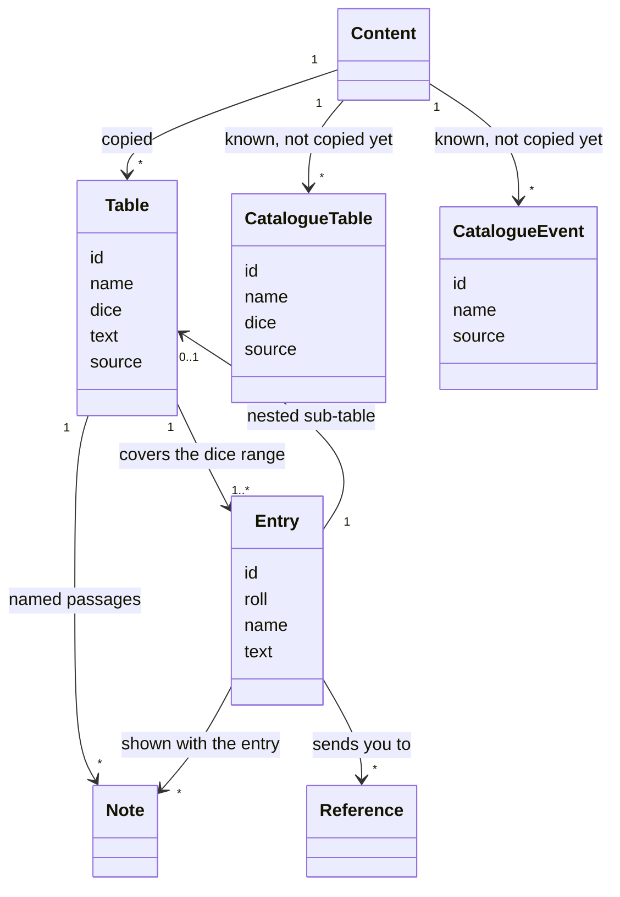

# Rules text in YAML

How the rules text is stored for the engine: files, IDs, the shape of a table, references between tables, and what is known but not copied yet. Why the text is copied at all is in [MVP scope](../design/mvp-scope.md#where-the-text-comes-from). Words are defined in the [glossary](../design/glossary.md). How the code loads and checks it: [architecture](architecture.md#content-the-rules-text). Decided in the R1 session.

## Structure



- **YAML holds the text, Python the behaviour**, both keyed by the same ID ([D1](../Readme.md#decisions)). The YAML holds no rules logic.
- **The text is copied as printed.** OCR damage is fixed against the original PDFs in `origin_rules/`, and page references become table names ("Roll on the Clinic table (p. 46)" becomes "Roll on the Clinic table"), and words that point at the page layout are dropped ("the Mission table below"). Nothing else changes. The Markdown in `gameRules/` is fixed in the same batch, so both copies say the same thing.
- **Obvious typos are fixed; other book errors stay as printed** (decided in R3). A misspelt word is fixed ("Scythe/showel" becomes "Scythe/shovel", "visit a stick" becomes "visit a park" as the weapon rules say). A missing word, odd grammar or anything whose meaning is unsure stays as printed ("1 dose be sacrificed") and goes to the list of [book errors kept as printed](../gameRules/book_errors.md), for a review session once the batches are done.
- **Every correction is shown to the user**: each batch reports every change to the printed text (OCR fixes, spacing and quotes included, page references, typos), with the printed words and the fix, so a misreading is caught before the batch is accepted.

## Files

```
src/alone_against_fear/content/
  catalogue.yaml          every table and numbered event not copied yet
  tables/
    town_exploration.yaml one file per table
    random_encounter.yaml
    search.yaml
    mission.yaml
  weapons/
    weapon_summary.yaml   the weapon summary: a list of weapons (R3)
  skills/
    skills.yaml           the Skills: a list (R2)
    arcane_skills.yaml    the Arcane Skills: a list (R2)
  characters/
    pregenerated.yaml     the two sample pregenerated characters (T1)
    (later places/, creatures/ … as the batches need)
```

- The files live in the package, so the engine finds them wherever it is installed.
- **One file per table.** The YAML batches run in parallel sessions, and one file per table keeps them from touching the same files.
- **The ID is inside the file**, not taken from its name or folder. Files can be moved or regrouped later without changing any ID. The loader reads every `*.yaml` under `content/`.

## IDs

Lowercase words joined by `_`, segments joined by `.`. **The first segment is the kind**: `table`, `mission`, `event`, `weapon`, `item`, `skill`, `arcane_skill`, `injury`, `mental_scar`, `pregenerated` so far; `creature`, `item`… are added by the batch that first needs them.

| What | ID | Rule |
| --- | --- | --- |
| A table | `table.town_exploration` | a short name from the table's heading, without "table"; `/` becomes `_or_` (`table.woods_or_park`). The heading's number is kept ("Random book table" gives `table.random_book`); "Search rolls table" is `table.search`, the name the rules use |
| An entry | `table.town_exploration.7` | table ID, then the roll as printed: `7`, `2-5` |
| An entry of a nested table | `table.random_encounter.3.3-5` | parent entry ID, then the roll |
| A named entry | `mission.bring_home_the_bacon` | an entry that is a thing of its own takes that thing's ID instead |
| A numbered event | `event.12` | `event`, then the event's number in the book |
| A Skill | `skill.agile` | `skill`, then its name without the XP cost, the same way as a table (`skill.strong_grip_on_reality`) |
| An Arcane Skill | `arcane_skill.curse` | `arcane_skill`, then its name, the same way |
| An Injury, a Mental Scar | `injury.limping`, `mental_scar.paranoia` | named entries of the Injury and Insanity tables: the kind, then the result's printed name |
| An item | `item.backpack` | `item`, then its printed name without the count, the same way as a table |
| A weapon | `weapon.axe` | `weapon`, then its heading in the weapon summary, the same way as a table: `/` becomes `_or_` (`weapon.hockey_stick_or_golf_club`), words in brackets are kept (`weapon.samurai_sword_authentic`) |
| A pregenerated character | `pregenerated.anna_miller` | `pregenerated`, then the name on the sheet |

- **IDs are stable.** The game state refers to content by ID only, so an ID is never renamed once used.
- **Rolls in IDs keep the book's numbers.** The book's "1,2)" is written `1-2`.
- **Named entries**: a mission is something the game keeps track of ("the mission you played last time"), so it gets a readable ID instead of `table.mission.3`. So do the results of the Injury and Insanity tables (decided in R2): the character keeps them for life and rerolls one they already have. An Insanity result is a Mental Scar, as the rules call it. Items got theirs in E6 ([items](#items)); creatures decide theirs in their own batch, with the same idea.
- **Numbered events** keep the book's number (`event.12`): the rules call them by it ("play event #12"). Fixed in E5a, which catalogues them so book mode can record them as played.

## A table

```yaml
id: table.random_encounter
name: Random Encounter table
dice: d6
source: gameRules/tables/5_2_random_encounters_table.md
notes:
  unique_creatures: When rolling on tables of Unique creatures, reroll any monster that …
entries:
  - roll: 3
    table:                 # roll d6, then another d6
      dice: d6
      entries:
        - roll: 6
          text: Roll on the Unique Vampires table.
          refs: [table.unique_vampires]
          notes: [unique_creatures]
```

| Field | Of | Meaning |
| --- | --- | --- |
| `id`, `name`, `dice` | table | `dice` is `d6`, `2d6` or `d66` so far |
| `source` | table | the readable Markdown copy |
| `text` | table | the table's own rules: when to roll it, its modifiers ("Roll at +1 if you have the Investigator Skill") |
| `notes` | table | named passages that some entries point to |
| `roll` | entry | one number, or a range `2-5` |
| `text` | entry | the entry as printed |
| `name`, `id` | entry | for named entries only |
| `refs` | entry | the tables and events the entry tells you to roll on or play |
| `notes` | entry | the table's notes that apply to this entry |
| `table` | entry | a nested table, for "roll d6, then another d6" |
| `item` | entry | the item the entry gives (`item.backpack`); two entries may give the same one |
| `count` | entry | how many objects it gives: a dice code (`2d6`) or a number; or one per thing, `{weapon.bow: 2d6+3}`, when the entry gives a choice |
| `uses` | entry | how many times the single item it gives can be used: a dice code or a number |
| `effects` | entry | what the entry changes while the character holds it (an Injury, a Mental Scar), with a single `amount` ([effects](#effects)); decided in E8 |

- **Entries cover the dice range exactly**: every result has one entry, no gaps, no overlaps. Nested tables too.
- **A nested table** is used only where the book prints one (Random Encounter). An entry that says "Roll d6. On a 1-5 … On a 6 …" stays one entry with its text, as printed (Town Exploration 7).
- **`text` and `notes` differ in who reads them.** The engine applies a table's own rules (it rolls Town Exploration in new boxes, it adds the Investigator bonus), so book mode does not need to show them on every roll. How they are shown is the interface's choice: the terminal shows them the first time the table is rolled in a game, and again on request (decided in E5a). A note is a rule about some results, which the player must apply by hand until the engine does: book mode shows it with every entry that points to it. The Random Encounter's sentence on Unique creatures is printed under 6 / 4-6 but applies to Unique Vampires on 3 / 6 and 6 / 1-3 too, so it is a note pointed to by all three.
- **Plain data is a field next to the text, added when the engine reads it** ([D1](../Readme.md#decisions), decided in E6): the text stays as printed, so the number is written twice ("d6 Garlic heads" and `count: d6`). Field shapes may change freely while no saved game depends on them.
- **`refs` name the tables and events an entry sends you to**, not how: roll the one named, choose one, roll to pick, only if a condition holds. That is behaviour, in Python by entry ID: `engine/leads.py` for the arrival tables (E5a), the result scripts of E10 later. Book mode offers the references of a copied entry whose behaviour is not written yet.

## A list of weapons

The weapon summary has no dice: it is a list of weapons, each with its rules. Its file holds the list's name and source, then the weapons in the book's order.

```yaml
name: Weapon summary table
source: gameRules/8_weapon_summary_table.md
weapons:
  - id: weapon.axe
    name: Axe
    text: >-
      Two-handed. Damage 2. If you are Strong (Expert), you may use it one-handed.
```

| Field | Of | Meaning |
| --- | --- | --- |
| `name`, `source` | list | the heading and the readable Markdown copy |
| `id`, `name`, `text` | weapon | the weapon's ID, its heading as printed, its rules as printed |

- **A weapon has its own ID**, so the tables that give one point to it: Random Weapon 2, "Chainsaw or authentic samurai sword (choose)", has `refs: [weapon.chainsaw, weapon.samurai_sword_authentic]`, and the player picks one.
- **A heading that names two weapons lists them as variants** (decided in E6): "Baseball bat or hammer" keeps its ID and text, and `weapon.baseball_bat` and `weapon.hammer` are weapons of their own with that text, so the character holds the exact one. A variant may add a sentence of its own (`extra`: the hammer drives stakes, the bat does not). Tables point to the variant they give; a heading with variants is never held.
- **One text per weapon, the summary's, completed from the tables** (the user, in E6): where a table entry says more about a weapon than the summary (the flashlight is a source of light), the summary takes it in. The table entries stay as printed. Each addition is in the [book errors](../gameRules/book_errors.md) ("Fixed or reworded").
- **Stats stay in the text** ("Damage 2") until the engine reads them (D1).

```yaml
  - id: weapon.baseball_bat_or_hammer
    name: Baseball bat or hammer
    text: >-
      +1 to hit zombies and flaming skeletons. Damage 1.
    variants:
      - {id: weapon.baseball_bat, name: Baseball bat}
      - id: weapon.hammer
        name: Hammer
        extra: >-
          Used to nail down doors and windows and to drive stakes through
          the hearts of vampires.
```

## Items

The Random Objects and Useful Stuff entries give the character something (decided in E6):

- **An item**: `item: item.rope`. The ID is the printed name without its count, the same way as a table (`item.garlic_heads` for "d6 Garlic heads", `item.flower_bunch_or_present`, `item.exorcism_ritual_book`); a long name is shortened to the thing (`item.leather_jacket`). Two tables may give the same item (`item.backpack`, `item.candles`): one item, one text, so their entries say the same words, each keeping its own count (reworded with the user, in the book errors).
- **A weapon**: its `refs`, as above.
- **Neither**: Random Objects 33 (d6 Food points: Food, a number on the sheet) and 45 and 61 (a random book: book mode until the books, E18). Python handles them by entry ID.
- **Three numbers, three meanings**: `count` is how many objects (d6 garlic heads, ammo, candles); `uses` is how many times one object serves (a First Aid Kit's d6+2 points, Salt's 6 doses, Strong coffee's 6 drinks); durability (Body armor's 4 Life points, the Helmet's 3) stays in the text until E13 (harm).

## A list of Skills

The Skills and the Arcane Skills have no dice either: one file each, a list in the book's order (decided in R2). The key of the list gives the kind: `skills` holds `skill.` IDs, `arcane_skills` holds `arcane_skill.` IDs.

```yaml
name: Skills
source: gameRules/1_2_skills.md
skills:
  - id: skill.agile
    name: Agile
    xp: 8
    text: >-
      Add +1 to your Defense rolls and rolls performed to climb, jump, or avoid danger.

      The bonus to Defense rolls does not stack with the bonus from the Dodge Skill. Use
      one or the other.
    expert: Add +2 to the above.
```

```yaml
name: Arcane Skills
source: gameRules/1_3_arcane_skills.md
arcane_skills:
  - id: arcane_skill.curse
    name: Curse
    xp: 2
    components: lighter or box of matches.
    sacrifice: 1 candle, 1 dose of bone powder.
    text: >-
      You may learn this ritual from one of the following books: …
```

| Field | Of | Meaning |
| --- | --- | --- |
| `name`, `source` | list | the heading and the readable Markdown copy |
| `id`, `name` | Skill | the Skill's ID, its name as printed without the XP cost |
| `xp` | Skill | the XP cost, a whole number |
| `text` | Skill | the rules as printed, without the Expert line: the Basic level and any note about both levels |
| `expert` | Skill | the Expert line, without its "Expert:" label; absent when the Skill has no Expert level |
| `components`, `sacrifice` | Arcane Skill | the labelled lines as printed, without their label; absent when not printed |
| `starting_gear` | Skill | what the Skill gives when taken at creation, as its text says: a list of `{id, count, uses}` (Bow: a bow and d6+3 arrows; Faith: the Religious symbol, see the [rulings](../design/rulings.md)); decided in E6 |
| `effects` | Skill | what the Skill changes, as numbers: a list of effects (below); decided in E7 |

- **The XP cost is a number** (the user, in R2): the engine will need it when Skills are bought with XP. The rest of D1 was decided in E6.
- **The Expert line is apart**, so a screen can show the level the character has, and a Skill with no `expert` has no Expert level. A note printed after the Expert line (Agile, Dodge) goes at the end of `text`: same words, the order changed.
- **The books an Arcane Skill is learned from stay in the text**; references to them wait for the books (E18).

### Effects

A Skill's or an entry's `effects` say what it changes, in the names of `effect_targets.py` ([rolls](../design/rolls.md)): the loader refuses a name it does not know, so a misspelt tag fails at load time instead of never matching.

```yaml
  - id: skill.agile
    effects:
      - {roll: defense, basic: 1, expert: 2, group: agile_or_dodge}
      - {roll: save, tags: [climb, jump, avoid_danger], basic: 1, expert: 2}
  - id: skill.tough
    effects:
      - {parameter: max_life, basic: 2, expert: 3}
```

| Field | Meaning |
| --- | --- |
| `roll` | a roll modifier: the roll type it changes (`attack`, `defense`, `save`, …) |
| `tags` | with `roll`: the roll must carry one of them; absent, every roll of the type |
| `group` | with `roll`: modifiers of one group do not stack, the highest applies (Agile and Dodge) |
| `parameter` | instead of `roll`: the parameter it changes (`max_life`, `carry_limit`, `food_interval`, …) |
| `basic`, `expert` | the amount at each level, a whole number (negative lowers); `expert` replaces `basic` ([rulings](../design/rulings.md#character)), present exactly when the Skill has an Expert line |
| `amount` | instead of `basic` and `expert`, for an entry's effect: there is no level |

An Injury or a Mental Scar is a table entry the character holds for life (E8): its `effects` take a single `amount`.

```yaml
  - roll: 2
    id: mental_scar.eating_disorder
    effects:
      - {parameter: food_interval, amount: -2}
```

- **Only numbers.** What a Skill does beyond a modifier (Dodge's balance on a natural 1, Faith turning vampires, Medic healing after an encounter) is Python keyed by the Skill's ID, written with the task that has its moment. Faith and Medic have no `effects`.
- **Bow and Martial Arts are bonuses** (the user, E7): +1 / +2 on bow or unarmed Attacks; the weapon keeps its own malus (-1 unskilled bow, -2 unarmed), so the totals are the book's.

## Pregenerated characters

The two sample pregenerated characters of the book, from their filled-in sheets (decided in T1): the drills start from them, and so will E17's quick run. One file, a list in the book's order, under the key `characters`.

```yaml
name: Sample pregenerated characters
source: gameRules/14_pregenerated_characters.md
characters:
  - id: pregenerated.anna_miller
    name: Anna Miller
    sanity: 9
    life: 10
    food: 4
    skills: [skill.will, skill.occultist]
    gear:
      - {id: weapon.pistol, count: 6}
      - {id: weapon.hammer}
```

- **Numbers and IDs only**: the gear's text is its weapon's or item's; the sheets' own words stay in the [Markdown](../gameRules/14_pregenerated_characters.md). `gear` is a list of `{id, count, uses}` like a Skill's starting gear (ammo is the weapon's `count`), with written numbers, never dice.
- **Where a sheet disagrees with the rules, the rules win**, as the Markdown says: Douglas has Strong at Basic, Anna one hammer. A YAML comment lists them. Douglas's book read waits for the books (E18).

## Known but not copied yet

- **`catalogue.yaml` lists every table not copied yet**, with its ID, name, dice and Markdown source. A reference to a catalogued table is valid.
- **It lists the 42 numbered events too**, with their ID, name (as printed, the case fixed where the OCR lost it) and source, but no dice. Book mode points to the source and records the event as played. The events batch (R6) moves them out like the tables.
- **Each batch moves its tables out** of the catalogue into their own files. When the catalogue is empty, Milestone 3 is done.
- **Book mode uses it as the fallback**: until a table is copied, the engine can still roll its dice and point to the Markdown file and entry number ([MVP scope](../design/mvp-scope.md#where-the-text-comes-from)).
- It lists the tables of `gameRules/tables/`, so every table ID is already fixed. Tables printed inside an event (the Fluid table) come with the events batch, R6. The optional random Skill tables come after the MVP.

## Checks

Tests over the whole content:

- every table and nested table covers its dice range exactly;
- every reference points to an existing ID: a table, an entry, or a catalogued table or event;
- every note an entry points to exists in its table;
- IDs are unique and follow the scheme;
- every pregenerated character's Skills and gear exist;
- every table file of `gameRules/tables/` is the source of exactly one table, copied or catalogued;
- no page reference is left in the text.

## Open

- Nothing for now. D1 is decided (E6): plain data is a YAML field next to the text, added when the engine reads it.
